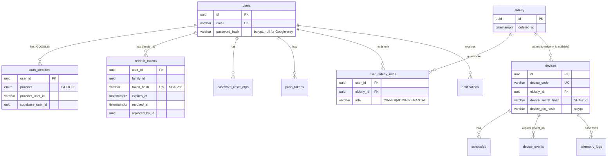
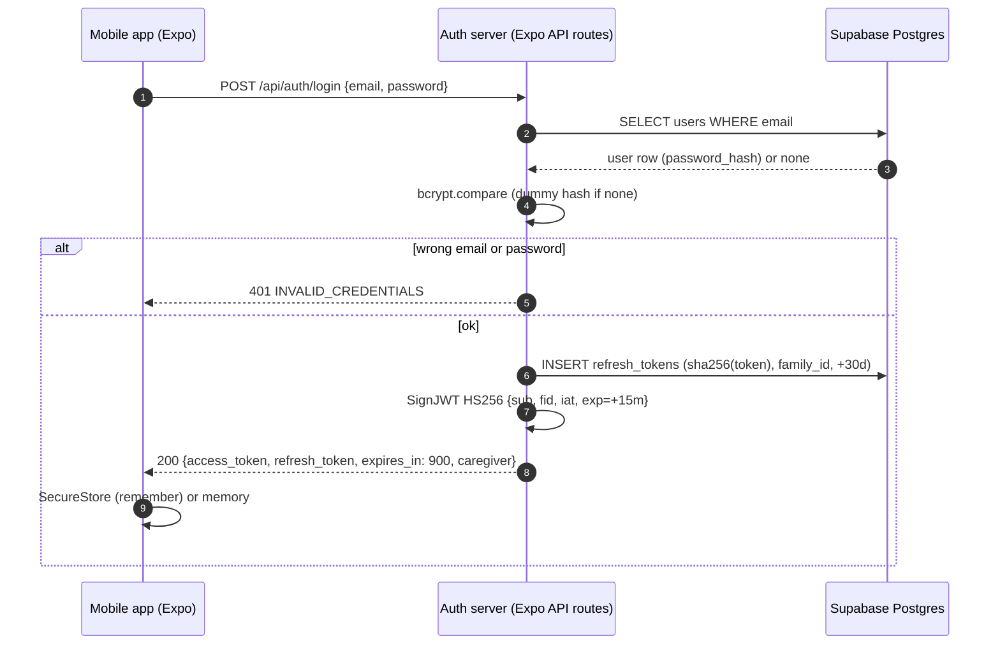
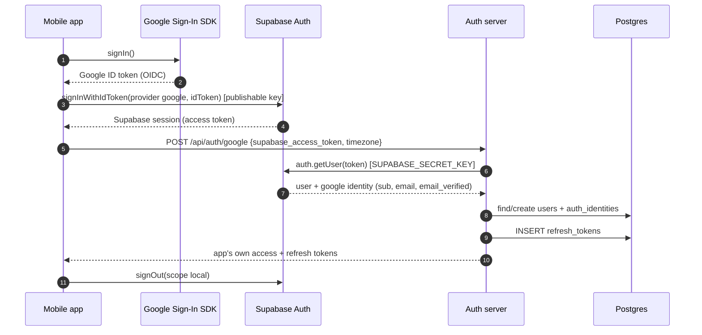
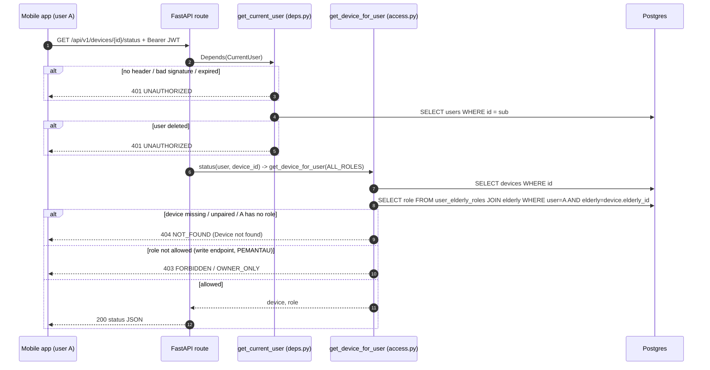
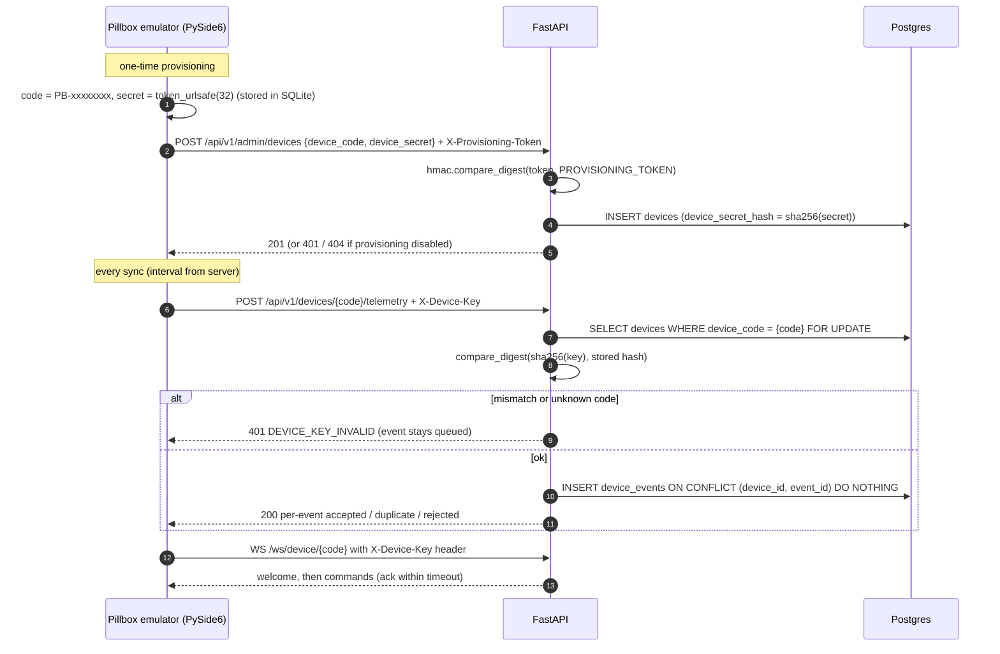
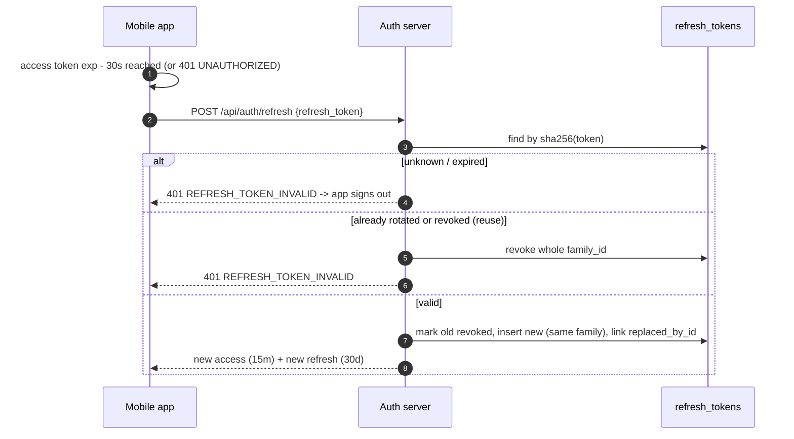

# PillCare: Authentication and Authorization Audit Notes

Prepared for the "Grand Bonus" report (CE739L). Read-only audit of the repository at branch `feat/eldery-option` (HEAD `d777e44`). No code was run; no `.env` file was read. Secrets are referred to by env var name only.

Tags: **[VERIFIED]** seen in code (with `path:line`) · **[INFERRED]** conclusion drawn from code · **[NOT FOUND]** searched, absent · **[BACKGROUND]** general library/protocol knowledge, not from this repo.

## TL;DR

1. Three kinds of callers are authenticated: **caregivers** (human users of the mobile app), **pillbox devices** (the PySide6 emulator), and a **factory provisioning caller** (shared token). The elderly person never authenticates.
2. Caregivers log in on a small **auth server inside the Expo app** (Expo API routes + Prisma) with email + bcrypt password, or Google via Supabase Auth. Both paths end with the app's **own HS256 JWT access token (15 min)** plus an **opaque, rotating refresh token (30 days, stored as SHA-256)**.
3. The FastAPI backend verifies that same JWT with the shared secret `JWT_ACCESS_SECRET` (PyJWT), then loads the user row. Devices authenticate with a per-device secret in `X-Device-Key` (SHA-256 at rest, constant-time compare).
4. Roles are **per elderly profile**, not global: `OWNER`, `ADMIN`, `PEMANTAU` (read-only), stored in `user_elderly_roles`. A device belongs to one elderly; a caregiver reaches a device only through a role on that elderly.
5. Authorization is enforced **server-side in every service function** (`services/access.py`): no role on the elderly gives `404`, an insufficient role gives `403`. The mobile UI only hides buttons. Under the Module 8 lens the scheme is a **hybrid**: stateless JWT signature check, plus a DB lookup of the user and of the role on every request, plus a stateful refresh-token table.

---

## 1. Entities that are authenticated

| Entity | Identifier | Credential | Where defined |
|---|---|---|---|
| Caregiver (user) | `users.id` (UUID), unique `email` | Password (bcrypt) and/or Google identity | Prisma model `User` [VERIFIED] `Mobile/prisma/schema.prisma:38-56`; read-only SQLAlchemy mirror `Backend/app/models/users.py:15` |
| Google identity of a caregiver | `auth_identities.provider_user_id` (Google `sub`), `supabase_user_id` | Google ID token, exchanged via Supabase Auth | [VERIFIED] `Mobile/prisma/schema.prisma:58-72` |
| Pillbox device | `devices.device_code` (`PB-XXXXXXXX`) or `devices.id` | Device secret sent as `X-Device-Key`; hash in `devices.device_secret_hash` | [VERIFIED] `Backend/app/models/devices.py:13-33` |
| Device PIN (caregiver pairing secret, not a login) | per device | 4-digit PIN, scrypt hash in `devices.device_pin_hash` | [VERIFIED] `Backend/app/models/devices.py:20`, `Backend/app/core/security.py:109-131` |
| Factory / provisioning caller | none (no identity) | Shared `PROVISIONING_TOKEN` in `X-Provisioning-Token` | [VERIFIED] `Backend/app/api/routes/admin.py:12-35`, `Backend/app/services/provisioning.py:24-29` |
| Elderly person | `elderly.id` | **Never authenticates** (data subject only) | [VERIFIED] `Backend/app/models/elderly.py:11`; [VERIFIED] `docs/ai/domain.md:8` |

Other credential-bearing records: `refresh_tokens` (`schema.prisma:74-90`), `password_reset_otps` (`schema.prisma:92-105`), `push_tokens` (`schema.prisma:107-119`). Column `devices.master_password_hash` exists but is unused [VERIFIED] `Backend/app/models/devices.py:19`, `docs/ai/domain.md:55`.

Service-to-service callers: the Mobile auth server calls Supabase Auth with the server-side secret `SUPABASE_SECRET_KEY` [VERIFIED] `Mobile/src/server/supabase-admin.ts:8-12`, `Mobile/src/server/env.ts:24-27`. There is no service-to-service call between the Mobile auth server and FastAPI; they share the database and the JWT secret [VERIFIED] `docs/ai/architecture.md:5-8,35-37`.

**Relationships** [VERIFIED]:
- `users` 1—N `user_elderly_roles` N—1 `elderly` (`Backend/app/models/elderly.py:27-33`; unique `(user_id, elderly_id)` and "exactly one OWNER" partial unique index, `Backend/migrations/0001_erd_domain_tables.sql:33-45`).
- `elderly` 1—N `devices` (`devices.elderly_id`, NULL = unpaired) (`Backend/app/models/devices.py:18`).
- So **a user does not own a device directly**: user → role on elderly → elderly's devices. "Owns the device" in the assignment sense = has any role on the device's elderly.

---

## 2. How they are authenticated

### 2.1 Caregiver: email + password

**Flow** [VERIFIED]:
1. App calls `POST {auth_server}/api/auth/register` or `/api/auth/login` with `auth: false` (`Mobile/src/lib/api/auth.ts:23-26`). The auth server runs on the Expo dev server, `:8081` in dev (`docs/ai/architecture.md:39-41`).
2. Body validated with zod: password 8–72 chars, email trimmed/lowercased (`Mobile/src/server/schemas.ts:3-29`).
3. Register: `bcrypt.hash(password, 10)` and insert; the unique email index rejects duplicates with `409 EMAIL_ALREADY_REGISTERED` (`Mobile/src/app/api/auth/register+api.ts:14-29`, `Mobile/src/server/passwords.ts:5,11-13`).
4. Login: find user by email, then **always one bcrypt compare** (against a dummy hash when the user is unknown or Google-only) so timing does not reveal registered emails; wrong → `401 INVALID_CREDENTIALS` (`Mobile/src/app/api/auth/login+api.ts:12-15`, `Mobile/src/server/passwords.ts:7-24`).
5. `issueTokens()` returns `{access_token, refresh_token, token_type: "Bearer", expires_in: 900}` (`Mobile/src/server/tokens.ts:49-71`).
6. App stores the pair via `tokenStore.startSession()` (`Mobile/context/auth-context.tsx:147-155`).

**Password storage** [VERIFIED]: `users.password_hash`, bcrypt via `bcryptjs` 3.0.3, cost factor 10 (`Mobile/src/server/passwords.ts:1-5`; version `Mobile/pnpm-lock.yaml:1851`). The cost was lowered from 12 to 10 for speed (comment at `passwords.ts:3-4`).

**Password reset** [VERIFIED]: 6-digit OTP from `crypto.getRandomValues` with rejection sampling (`Mobile/src/server/otp.ts:9-15`), stored as HMAC-SHA256 keyed by `OTP_PEPPER` or a key derived from `JWT_ACCESS_SECRET` (`otp.ts:19-25`), 10-min TTL, 60 s resend cooldown, max 5 attempts counted atomically (`otp.ts:4-6`, `Mobile/src/app/api/auth/reset-password+api.ts:28-43`). Same response for unknown emails (`forgot-password+api.ts:7-14`). A successful reset revokes all refresh tokens (`reset-password+api.ts:52-53`).

### 2.2 Caregiver: Google sign-in (via Supabase Auth)

**Flow** [VERIFIED]:
1. App gets a **Google ID token** from the native Google Sign-In SDK `@react-native-google-signin/google-signin` 16.1.5 (`Mobile/src/lib/google-signin.ts:37-47`; version `pnpm-lock.yaml:1279`).
2. App exchanges it with Supabase: `supabase.auth.signInWithIdToken({ provider: 'google', token })` using the **publishable** key; the Supabase session is not persisted (`Mobile/context/auth-context.tsx:182-184`, `Mobile/utils/supabase.ts:7-19`).
3. App sends the **Supabase access token** to `POST /api/auth/google` (`auth-context.tsx:186-189`).
4. Auth server calls `supabaseAdmin().auth.getUser(token)` with `SUPABASE_SECRET_KEY`, a **network call** to Supabase, not a local JWT check (`Mobile/src/app/api/auth/google+api.ts:94-98`).
5. It extracts the Google identity (`sub`, `email`, `email_verified`) (`google+api.ts:24-39`), then finds or creates `users` + `auth_identities`. It links to an existing password account only if Google says the email is verified, otherwise `409` (`google+api.ts:41-89`).
6. It issues **the app's own tokens**, same as password login (`google+api.ts:112-117`), and the app signs out of Supabase locally (`auth-context.tsx:193-196`).

[BACKGROUND] Supabase's `signInWithIdToken` verifies the Google ID token (signature against Google's published JWKS, audience = configured client ID, expiry) before minting a Supabase session. This repo does not do that verification itself; it trusts Supabase's `getUser` answer.

### 2.3 Tokens issued to caregivers

| Property | Value | Evidence |
|---|---|---|
| Access token type | JWT (JWS compact `header.payload.signature`) | [VERIFIED] `Mobile/src/server/tokens.ts:24-31` |
| Algorithm | HS256 (HMAC-SHA256, symmetric) | [VERIFIED] `tokens.ts:26`; verify allow-list `tokens.ts:36` and `Backend/app/core/security.py:31,55-60` |
| Header | `{alg: "HS256", typ: "JWT"}` | [VERIFIED] `tokens.ts:26` |
| Claims | `sub` = `users.id`, `fid` = refresh-token family id, `iat`, `exp` | [VERIFIED] `tokens.ts:25-29` |
| Claims absent | no `iss`, `aud`, `jti`, roles or scopes | [VERIFIED] `tokens.ts:25-29` (only these are set) |
| Access expiry | 900 s (15 min) | [VERIFIED] `tokens.ts:8` |
| Signing secret | env `JWT_ACCESS_SECRET` (≥ 32 chars enforced on the Mobile side), same value in both servers | [VERIFIED] `Mobile/src/server/env.ts:11-15`; `Backend/app/core/config.py:66`; `docs/ai/architecture.md:35-37` |
| Refresh token | Opaque, 32 random bytes base64url | [VERIFIED] `tokens.ts:44-46` |
| Refresh storage (server) | SHA-256 hex in `refresh_tokens.token_hash`, 30-day expiry, `family_id`, `replaced_by_id`, `revoked_at` | [VERIFIED] `tokens.ts:9,55-63`; `schema.prisma:74-90` |
| Refresh rotation | Each refresh revokes the old row and issues a new pair in the same family; reusing a rotated/revoked token **revokes the whole family** (theft detection); atomic claim against races | [VERIFIED] `tokens.ts:92-119` |
| Logout | Revokes the refresh family; always 204 | [VERIFIED] `Mobile/src/app/api/auth/logout+api.ts:5-19` |
| Change password | Revokes all other families, keeps the current one | [VERIFIED] `Mobile/src/app/api/auth/change-password+api.ts:21-23` |
| Client storage (native) | `expo-secure-store` 57.0.4 (iOS Keychain / Android Keystore), `AFTER_FIRST_UNLOCK_THIS_DEVICE_ONLY`; if "Ingat saya" (remember me) is off, kept in memory only | [VERIFIED] `Mobile/src/lib/api/token-store.ts:4-9,29-31,126-130`; version `pnpm-lock.yaml:2558` |
| Client storage (web build) | `localStorage` (remembered) or `sessionStorage` | [VERIFIED] `token-store.ts:8-11` |
| Absolute session cap | 30 days after the last interactive login (client side) | [VERIFIED] `token-store.ts:21-22`, `Mobile/context/auth-context.tsx:41-44` |
| How attached | `Authorization: Bearer <access_token>` on REST (auth server and FastAPI); first WebSocket message `{type:"auth", token}` on `/ws/app` | [VERIFIED] `Mobile/src/lib/api/client.ts:76`, `Mobile/lib/api.ts:150,666` |
| Client refresh logic | Refresh 30 s before `exp` (decoded client-side **without** verification, only to read `exp`); on a `401 UNAUTHORIZED` refresh once (single-flight) and retry; if refresh fails, end the session | [VERIFIED] `client.ts:101-123,130-159,161-187`; `Mobile/src/config.ts:52` |

**ID token vs access token.** [VERIFIED] Only the Google sign-in path has an OIDC **ID token** (from Google, `google-signin.ts:46`); it is used once to prove identity to Supabase and is then discarded. The app's own system issues **no ID token**. User profile data for display comes back in the login response body (`caregiver: {id, full_name}`, `login+api.ts:18`) and from `GET /api/setting` (`Mobile/src/app/api/setting/index+api.ts:10-13`). The app's JWT is purely an **access token**. A **refresh token** (the "third sibling") is used and rotated.

### 2.4 Pillbox device (emulator)

**Provisioning ("factory")** [VERIFIED]:
1. In the emulator the user presses "Daftarkan Perangkat" (`SmartDevice/smart_pillbox/gui/main_window.py:503-525`).
2. The emulator generates `device_code = "PB-" + 8 hex` and `secret = secrets.token_urlsafe(32)` itself and keeps them as "pending" so a retry re-sends the same identity (`SmartDevice/smart_pillbox/core/sync.py:75-86`).
3. `POST /api/v1/admin/devices` with `X-Provisioning-Token` and body `{device_code, device_secret}` (`sync.py:101-111`). The token comes from env `PILLCARE_PROVISIONING_TOKEN`, or the emulator reads `PROVISIONING_TOKEN` from `SmartDevice/.env` or `Backend/.env`, or asks in a password dialog (`SmartDevice/smart_pillbox/config.py:85-105`, `main_window.py:509-519`).
4. Backend checks the token with `hmac.compare_digest`. If `PROVISIONING_TOKEN` is unset the endpoint answers `404` (feature off); a wrong token gives `401 PROVISIONING_TOKEN_INVALID` (`Backend/app/services/provisioning.py:24-29`). A caller-supplied secret must be ≥ `device_secret_min_length` (16) (`provisioning.py:32-36`, `config.py:73`); otherwise the server generates one (`security.py:79-80`).
5. The server stores only `sha256(secret)` (`security.py:87-88`). The emulator stores code + secret **in plaintext** in its local SQLite `device_state` table (`sync.py:132-135`; table `SmartDevice/smart_pillbox/db/schema.sql:6-9`).

**Every device request** [VERIFIED]:
- REST: `/api/v1/devices/{code}/heartbeat | config | config-ack | telemetry` with header `X-Device-Key` (`sync.py:144-148`). FastAPI dependency `AuthenticatedDevice` → `authenticate_device()` looks up the device by the **path** code (or UUID), hashes the provided key with SHA-256 and compares in constant time; the dummy hash is used when the device does not exist, so unknown and known codes take the same time; failure → `401 DEVICE_KEY_INVALID` (`Backend/app/api/deps.py:89-100`, `Backend/app/services/device_protocol.py:35-66`, `security.py:91-100`).
- WebSocket `/ws/device/{device_code}`: `X-Device-Key` header (the emulator sends it, `SmartDevice/smart_pillbox/core/ws_client.py:74-79`) or a first message `{type:"auth", device_key}`; same check; failure closes with code 4401 (`Backend/app/api/routes/ws.py:39-58,66-70`).
- No token is issued to devices: the static secret is sent on every request [VERIFIED]. Secrets can be rotated with `POST /api/v1/admin/devices/{code}/rotate-secret` (provisioning token) (`admin.py:28-35`).

**Device PIN** (caregiver-facing, 4 digits) [VERIFIED]: set by the first caregiver at pairing, stored as `scrypt$N$r$p$salt$digest` with N=2^14, r=8, p=1, 16-byte random salt, dkLen 32, verified with `hmac.compare_digest` (`security.py:33-37,109-131`). Brute force is limited to 5 failures per (user, device) per 300 s → `429 TOO_MANY_ATTEMPTS`, held **in process memory** (`Backend/app/services/pin_attempts.py:1-43`, `device_management.py:130-136`, `config.py:138-139`).

### 2.5 Libraries, versions, and inner workings

| Library (version, source) | Used for | Inner workings |
|---|---|---|
| `jose` 6.2.13 (`Mobile/pnpm-lock.yaml:3097`, installed `node_modules/jose/package.json`) | Sign and verify the HS256 access JWT on the auth server | Signing: base64url(header) + "." + base64url(payload), HMAC-SHA256 over that string with Web Crypto `crypto.subtle.sign` [VERIFIED] `node_modules/jose/dist/webapi/lib/jws_sign.js:34`. Verification recomputes it with `crypto.subtle.verify` [VERIFIED] `.../lib/jws_verify.js:65`, then checks `exp <= now - tolerance` → `JWTExpired` [VERIFIED] `.../lib/jwt_claims_set.js:84-86`. The repo passes `algorithms: ['HS256']` so a token whose header says another alg (e.g. `none`) is rejected [VERIFIED] `Mobile/src/server/tokens.ts:36`. |
| `PyJWT` 2.15.0 with `cryptography` 50.0.1 (`Backend/uv.lock:1022-1023,224-225`; installed in `Backend/.venv`) | Verify the same JWT in FastAPI | `jwt.decode()` splits the token, rejects any `alg` not in the allow-list [VERIFIED] `.venv/.../jwt/api_jws.py:402-403`, recomputes HMAC-SHA256 and compares with `hmac.compare_digest` (constant time) [VERIFIED] `.venv/.../jwt/algorithms.py:496-497`, enforces `options.require` claims [VERIFIED] `.venv/.../jwt/api_jwt.py:426-433` (repo requires `exp`, `sub`: `security.py:59`), and raises `ExpiredSignatureError` when `exp <= now - leeway` (leeway 0) [VERIFIED] `.venv/.../jwt/api_jwt.py:499-513`. |
| `bcryptjs` 3.0.3 (`pnpm-lock.yaml:1851`) | Password hashing | Pure-JS bcrypt. `genSalt` takes 16 random bytes [VERIFIED] `node_modules/bcryptjs/index.js:100,508`; hash format `$2b$<cost>$<22-char salt><31-char hash>` [VERIFIED] dummy hash at `Mobile/src/server/passwords.ts:9`; compare re-hashes the candidate with the stored salt and does a constant-time string compare (`safeStringCompare`) [VERIFIED] `bcryptjs/index.js:211,268`. [BACKGROUND] bcrypt runs the Blowfish "EksBlowfish" key setup 2^cost times (2^10 here), making each guess slow on purpose; input is limited to 72 bytes, which matches the 72-char cap in `schemas.ts:4`. |
| Web Crypto (`crypto.subtle`, `crypto.getRandomValues`) | SHA-256 of refresh tokens, HMAC-SHA256 of OTPs, random tokens | [VERIFIED] `Mobile/src/server/crypto.ts:15-28`. Note: the custom `timingSafeEqual` exits early on a length mismatch (`crypto.ts:30-34`); both inputs are fixed-length hex, so this is fine [INFERRED]. |
| `@supabase/supabase-js` / `@supabase/auth-js` 2.118.0 (`pnpm-lock.yaml:1397,1420`) | Google ID token exchange (client) and `auth.getUser` / `admin.deleteUser` (server) | [BACKGROUND] `getUser(jwt)` calls `GET {SUPABASE_URL}/auth/v1/user` with the token; Supabase validates it and returns the user and identities. The repo labels it a network call [VERIFIED] `google+api.ts:94`. |
| `@react-native-google-signin/google-signin` 16.1.5 | Obtain the Google ID token natively | [BACKGROUND] Uses Google Identity Services / Google Sign-In SDK; returns an OIDC ID token whose `aud` is the configured web client ID (`EXPO_PUBLIC_GOOGLE_WEB_CLIENT_ID`, `google-signin.ts:14-24`). |
| `expo-secure-store` 57.0.4 | Token storage on the phone | [BACKGROUND] iOS Keychain services; on Android, values are encrypted with a key held in the Android Keystore and stored in SharedPreferences. The repo chunks values above 2000 chars (`token-store.ts:24-27,78-85`). |
| Python `hashlib.scrypt`, `hashlib.sha256`, `hmac.compare_digest`, `secrets` (stdlib) | Device PIN, device secret, provisioning-token compare | [VERIFIED] `Backend/app/core/security.py:18-131`. [BACKGROUND] scrypt is memory-hard (≈ 128·N·r bytes ≈ 16 MiB per hash here), which slows brute-force on GPUs; SHA-256 without salt is fine for 256-bit random secrets because they cannot be guessed. |
| FastAPI 0.141.1 `HTTPBearer(auto_error=False)` + `Depends` (`uv.lock:311-312`) | Extract `Authorization: Bearer`; dependency injection of `CurrentUser` / `AuthenticatedDevice` | [VERIFIED] `Backend/app/api/deps.py:22,35-42,86,100`. `auto_error=False` means a missing header yields `None`, which the code turns into the project's own `401 UNAUTHORIZED` envelope (`deps.py:40-41`, `Backend/app/core/errors.py:37-38`). |
| `PyJWKClient` (PyJWT) | Only for the unused `AUTH_MODE=supabase` path (ES256/RS256 via Supabase JWKS) | [VERIFIED] `security.py:44-74`, default `auth_mode = "app_jwt"` at `config.py:65`. |

### 2.6 Classification under the Module 8 lens

- **Auth server (`requireAuth`)**: token-based. It only verifies the JWT signature and `exp`, with no DB lookup (`Mobile/src/server/auth-guard.ts:5-10`, `tokens.ts:33-42`) [VERIFIED]. Individual handlers then load the user and treat a deleted user as `401` (`Mobile/src/server/users.ts:15-22`).
- **FastAPI (`get_current_user`)**: **hybrid**. Step 1 trusts the token (signature + `exp`, no session table, `fid` ignored) (`deps.py:45-61`). Step 2 always does a DB lookup of the user, `db.get(User, sub)`, and rejects deleted accounts (`deps.py:64-77`). Step 3: every protected service queries `user_elderly_roles` for the role (`Backend/app/services/access.py:19-30`). Roles are **not** in the token, so a role change takes effect on the next request [INFERRED from claims list + `access.py`].
- **Refresh flow**: session-like (stateful): the server keeps `refresh_tokens` rows and checks them on every refresh (`tokens.ts:94-119`).
- **Devices**: neither token- nor session-based in the JWT sense. They use an **API-key** style shared secret checked against the DB on every request (`device_protocol.py:55-66`) [VERIFIED].
- Implementation choice: **self-implemented** token issuing (jose/PyJWT/bcrypt) with a **third-party IdP (Google via Supabase Auth)** for SSO only, plus backend glue (`google+api.ts`). [VERIFIED] `docs/ai/architecture.md:22-25`.

---

## 3. Roles and access levels

| Role | Who has it | Where defined | What it can access |
|---|---|---|---|
| `OWNER` | Creator of an elderly profile; exactly one per elderly; transferable | Enum `Backend/app/models/enums.py:6-9`; DB CHECK + partial unique index `Backend/migrations/0001_erd_domain_tables.sql:38,44-45`; assigned at `Backend/app/services/elderly.py:52` | Everything ADMIN can do, plus: delete elderly (`elderly.py:174`), transfer ownership (`elderly.py:287`), change device PIN (`device_management.py:291`), unpair device (`device_management.py:406`), remove any non-owner caregiver (`elderly.py:271-273`) |
| `ADMIN` | Caregiver invited as ADMIN by an OWNER/ADMIN | Same enum; invite schema allows only `ADMIN` or `PEMANTAU` (`Backend/app/schemas/elderly.py:78-81`) | `EDITOR_ROLES` (`enums.py:12`): edit elderly, invite, pair a device to the elderly, edit device settings, schedules, alarm, calibrate, refill mode/refills, manual dose confirmation, late release (see section 4) |
| `PEMANTAU` (monitor) | Caregiver invited as PEMANTAU, or anyone who joins a paired device with the correct PIN | Assigned in `device_management.py:281` (join) | `ALL_ROLES` (`enums.py:13`) read endpoints only; may remove themselves (`elderly.py:273`) and edit their own notification preferences (`elderly.py:341-344`) |
| No role (unrelated user) | Any other authenticated caregiver | `access.py:42-44,64-66` | Nothing for that elderly; gets `404 NOT_FOUND` (existence is hidden) |
| Device | A provisioned pillbox | `deps.py:89-100` | Only the four device-protocol endpoints and `/ws/device/{own code}`, and only for its own row |
| Provisioning caller | Holder of `PROVISIONING_TOKEN` | `admin.py:19-35` | Create devices, rotate device secrets |

Notes:
- Roles are **per elderly, not global, and not per device** [VERIFIED] `docs/ai/domain.md:10-20`, `access.py:1-6`. A caregiver can be OWNER of one elderly and PEMANTAU of another.
- There is **no global "system admin" user role** [NOT FOUND]: searched `Role` enum, `users` model (`schema.prisma:38-56`) and `admin` routes. The `/admin` routes are guarded by a shared token, not by a user role.
- Devices have no roles [NOT FOUND]: no role column on `devices` (`models/devices.py:13-33`).

---

## 4. How authorization is implemented

### 4.1 Mechanism

- **Authentication gate**: FastAPI dependency `CurrentUser = Annotated[User, Depends(get_current_user)]` on every caregiver route (`deps.py:86`). Device routes use `AuthenticatedDevice` (`deps.py:100`).
- **Authorization gate**: inside each service function, through two helpers in `Backend/app/services/access.py` [VERIFIED]:
  - `require_role(session, user_id, elderly_id, allowed)` for elderly-scoped routes (`access.py:39-47`).
  - `get_device_for_user(session, user_id, device_id, allowed)`: loads the device, rejects unpaired devices, then looks up the caller's role on **the device's elderly** (`access.py:50-69`).
  - Both: no role → `404 NOT_FOUND`; role not in `allowed` → `403 FORBIDDEN`, or `403 OWNER_ONLY` when only OWNER is allowed (`access.py:33-36`).
  - `get_role` also requires `elderly.deleted_at IS NULL` (`access.py:19-30`).
- Per-user resources (notifications) are filtered by `Notification.user_id == user.id` (`Backend/app/services/notification_feed.py:85,98,112-116,126,152,185,201`).
- **Routers are thin** (rule: `Backend/CLAUDE.md`): routers do not authorize themselves, so the authorization evidence for each route is in the service it calls.

### 4.2 Endpoint table (FastAPI, prefix `/api/v1` unless noted)

AuthN column: **U** = `CurrentUser` (Bearer JWT), **D** = `AuthenticatedDevice` (`X-Device-Key`), **P** = provisioning token, **—** = none.
Roles: **ALL** = any role on the elderly; **ED** = OWNER/ADMIN; **OWN** = OWNER only. "IDOR-safe" means an unrelated user changing the ID gets 404.

| Method & path | AuthN | Authorization check (service) | IDOR-safe |
|---|---|---|---|
| GET `/health`, GET `/health/db` (root) | — | none (`routes/health.py:12-25`) | n/a (no user data) |
| GET `/me` | U | returns the caller only (`routes/me.py:18-21`) | yes [VERIFIED] |
| POST `/devices/{code}/heartbeat` | D | device from path + key (`routes/device_protocol.py:24-28`) | yes [VERIFIED] |
| GET `/devices/{code}/config` | D | same (`device_protocol.py:31-45`) | yes [VERIFIED] |
| POST `/devices/{code}/config-ack` | D | same (`device_protocol.py:48-52`) | yes [VERIFIED] |
| POST `/devices/{code}/telemetry` | D | same; events written with `device.id` (`device_protocol.py:55-58`, `services/telemetry.py:147,226,238`) | yes [VERIFIED] |
| POST `/devices/pairing/scan` | U | **none beyond login**; returns device id, paired flag and owner elderly nickname (`devices.py:44-46`, `device_management.py:201-214`) | see Gap G6 |
| POST `/devices` (pair) | U | device must be unpaired (`409 DEVICE_ALREADY_PAIRED`), caller ED on target elderly (`device_management.py:216-233`) | yes for elderly; first-claim for device (Gap G5) |
| GET `/devices` | U | SQL join on caller's `user_elderly_roles` (`device_management.py:302-313`) | yes [VERIFIED] |
| POST `/devices/{id}/join` | U | correct PIN + rate limit, grants PEMANTAU (`device_management.py:262-285`) | by design (PIN) |
| PUT `/devices/{id}/pin` | U | OWN + current PIN (`device_management.py:288-299`) | yes [VERIFIED] |
| GET `/devices/{id}` | U | ALL (`device_management.py:340-341`) | yes [VERIFIED] |
| PUT `/devices/{id}` | U | ED; moving to another elderly also needs ED there (`device_management.py:367-386`) | yes [VERIFIED] |
| DELETE `/devices/{id}` | U | OWN (`device_management.py:405-406`) | yes [VERIFIED] |
| GET `/devices/{id}/status` | U | ALL (`device_management.py:412-413`) | yes [VERIFIED] |
| GET `/devices/{id}/clock` | U | ALL (`device_management.py:448-449`) | yes [VERIFIED] |
| POST `/devices/{id}/clock/calibrate` | U | ED + PIN (`device_management.py:462-465`) | yes [VERIFIED] |
| POST `/devices/{id}/alarm` | U | ED (`device_management.py:489-494`) | yes [VERIFIED] |
| GET `/devices/{id}/events` | U | ALL (`device_management.py:514-517`) | yes [VERIFIED] |
| POST `/devices/{id}/refill-mode` | U | ED (`services/stock.py:40-41`) | yes [VERIFIED] |
| POST `/devices/{id}/refills` | U | ED (`stock.py:68-71`) | yes [VERIFIED] |
| GET `/devices/{id}/refills` | U | ALL (`stock.py:129-132`) | yes [VERIFIED] |
| GET `/devices/{id}/stock` | U | ALL (`stock.py:163-166`) | yes [VERIFIED] |
| GET `/devices/{id}/schedules` | U | ALL (`services/schedules.py:195-196`) | yes [VERIFIED] |
| PUT `/devices/{id}/schedules` | U | ED (`schedules.py:373-380`) | yes [VERIFIED] |
| POST `/devices/{id}/schedules` | U | ED (`schedules.py:250-251`) | yes [VERIFIED] |
| POST `/devices/{id}/schedules/validate` | U | ALL (`schedules.py:361-362`) | yes [VERIFIED] |
| PUT / DELETE `/devices/{id}/schedules/{schedule_id}` | U | ED, and the schedule must belong to that device (`schedules.py:282-293,304,350`) | yes [VERIFIED] (no cross-device schedule swap) |
| POST `/elderly` | U | caller becomes OWNER (`services/elderly.py:40-52`) | n/a |
| GET `/elderly` | U | join on caller's roles, paginated (`elderly.py:83-89`; `routes/elderly.py:30-33`) | yes [VERIFIED] |
| GET `/elderly/{id}` | U | ALL (`elderly.py:128-129`) | yes [VERIFIED] |
| PUT `/elderly/{id}` | U | ED (`elderly.py:157-158`) | yes [VERIFIED] |
| DELETE `/elderly/{id}` | U | OWN (`elderly.py:173-174`) | yes [VERIFIED] |
| POST `/elderly/{id}/caregivers` | U | ED; invite role limited to ADMIN/PEMANTAU (`elderly.py:190-193`, `schemas/elderly.py:80`) | yes [VERIFIED] |
| GET `/elderly/{id}/caregivers` | U | ALL (`elderly.py:243-244`) | yes [VERIFIED] |
| DELETE `/elderly/{id}/caregivers/{cid}` | U | ALL; OWNER cannot be removed; non-OWNER may only remove self (`elderly.py:260-273`) | yes [VERIFIED] |
| POST `/elderly/{id}/transfer-ownership` | U | OWN (`elderly.py:284-287`) | yes [VERIFIED] |
| GET / PUT `/elderly/{id}/notification-preferences` | U | ALL; reads/writes the caller's own row (`elderly.py:325-344`) | yes [VERIFIED] |
| GET `/elderly/{id}/journal/calendar`, `/summary`, `/{day}` | U | ALL (`services/journal.py:167-168,232-233,265-266`) | yes [VERIFIED] |
| PUT `/journal/dose-logs/{log_id}/manual-confirmation` | U | loads the log, then ED on `log.elderly_id` (`journal.py:285-295`) | yes [VERIFIED] |
| GET `/notifications`, PUT `/notifications/read-all`, DELETE `/notifications` | U | `user_id == caller` (`notification_feed.py:82-98,149-152,193-201`) | yes [VERIFIED] |
| GET / DELETE `/notifications/{id}`, PUT `/{id}/read`, PUT `/{id}/resolve` | U | `user_id == caller` (`notification_feed.py:112-116,119-126,142-143,161-162,181-185`) | yes [VERIFIED]; covered by test `Backend/tests/test_notification_delete.py:31-32` |
| POST `/notifications/{id}/late-release`, POST `/{id}/confirm-taken` | U | notification must be the caller's, then ED on the device (`services/late_dose.py:86-101,110,159`) | yes [VERIFIED] |
| POST `/admin/devices`, POST `/admin/devices/{code}/rotate-secret` | P | constant-time token compare (`provisioning.py:24-29`) | n/a |
| WS `/ws/device/{device_code}` (root) | D | key checked against the path code (`ws.py:42-58,66-70`) | yes [VERIFIED] |
| WS `/ws/app` (root) | U (first message) | pushes only for the caller's `user_id` and elderly ids loaded at connect (`ws.py:152-190`, `services/app_hub.py:55,88`) | yes at connect; see Gap G7 |

The path-param exact lines for each route are in `Backend/app/api/routes/{devices,schedules,elderly,journal,notifications,admin,device_protocol,ws}.py` (listed in the Evidence index). Total: 56 backend operations per `docs/postman/PillCare.postman_collection.json:4`.

**Auth server routes** (Expo, base `/api`) [VERIFIED]:

| Method & path | AuthN | Scope |
|---|---|---|
| POST `/auth/register`, `/auth/login`, `/auth/google`, `/auth/refresh`, `/auth/logout`, `/auth/forgot-password`, `/auth/reset-password` | public (credential in body) | n/a |
| PUT `/auth/change-password` | `requireAuth` | own user from `sub` (`change-password+api.ts:10-12`) |
| GET / PUT / DELETE `/setting` | `requireAuth` | own user from `sub` (`setting/index+api.ts:10-66`) |
| GET / POST `/setting/push-tokens` | `requireAuth` | `where userId` (`push-tokens/index+api.ts:8-39`) |
| DELETE `/setting/push-tokens/{id}` | `requireAuth` | `deleteMany where {id, userId}` → 404 for others (`push-tokens/[push_token_id]+api.ts:8-16`) |

No auth-server route takes a user id from the URL or body; identity always comes from the token's `sub` [VERIFIED].

### 4.3 IDOR analysis: can user A touch user B's device?

Code path for `GET /api/v1/devices/{B_device_id}/status` called by user A [VERIFIED]:
1. `HTTPBearer` extracts the token → `get_current_user` verifies HS256 + `exp` → `user = db.get(User, sub)` (`deps.py:35-77`).
2. Route `device_status` → `svc.status(db, user, device_id, ...)` (`routes/devices.py:95-97`).
3. `get_device_for_user(..., ALL_ROLES)` loads the device; it has `elderly_id = E_B`; `get_role(A, E_B)` returns `None` → **`404 NOT_FOUND` "Device not found"** (`access.py:58-66`, `errors.py:45-46`).

Every device-ID and elderly-ID route above passes through the same helper (table 4.2), so changing the ID in the URL gives `404`. Changing IDs in the **body** is also checked: `pair` checks the role on `body.elderly_id` (`device_management.py:230`), `update_settings` checks the role on the new `elderly_id` (`device_management.py:381-383`). For schedules, the schedule id must belong to the path device (`schedules.py:286`). The user id is never taken from the request; it always comes from the token `sub` [VERIFIED].

The only ways to gain access to someone else's device are by design: knowing its **PIN** (`join`, rate-limited) or being **invited** by an OWNER/ADMIN. One edge case is claiming an **unpaired** device by its code (Gap G5).

Existing tests [VERIFIED]: PEMANTAU gets 403 on alarm/edit (`Backend/tests/test_roles_and_commands.py:30-48`); wrong PIN rate limiting (`:51`); another user's notification → 404 (`tests/test_notification_delete.py:31-32`); bad device key → 401 `DEVICE_KEY_INVALID` (`tests/test_telemetry.py:203-204`). A test for "unrelated user requests another user's device → 404" was **[NOT FOUND]** (searched `tests/*.py` for `404`).

### 4.4 Device-side authorization

- The device is identified by the **path** `{device_id}` and must present the key whose hash is stored on **that** row (`device_protocol.py:61-66`). Device A's key used on device B's path fails the hash compare → `401 DEVICE_KEY_INVALID` [VERIFIED].
- All writes use the authenticated `device` object (`device.id`, `device.elderly_id`), never an id from the body (`services/telemetry.py:147,226,238,309,344`) [VERIFIED]. The telemetry body schema has no device field [INFERRED: no `device_id`/`device_code` match in `app/schemas/device_protocol.py`].
- Schedules referenced by device events must belong to that device (`telemetry.py:269-289`) [VERIFIED].
- On the WebSocket, a newer connection replaces the old one for the same device (`docs/ai/domain.md:60`, close code `WS_CLOSE_REPLACED` `ws.py:40`).

### 4.5 Backend vs UI

- Real enforcement is in the backend (section 4.1).
- The mobile UI also checks roles, but only to hide controls: `canEdit` / `canUnpair` (`Mobile/lib/devices.ts:43-51`, used in `Mobile/src/components/pillbox/device-list.tsx:70`). The comments state "server-enforced" (`devices.ts:211,252`). These UI checks are **not** authorization: a user calling the API directly (Postman/curl) is still stopped by the backend [VERIFIED by section 4.2].
- One piece of UI-only state: "hiding" a pillbox for a non-owner is local to the phone and has no backend effect (`Mobile/lib/devices.ts:289-290`).
- Database layer: RLS is enabled on every Backend table with no policies, so only the server's privileged DB role can read or write. The publishable Supabase key cannot read tables (`Backend/migrations/0001_erd_domain_tables.sql:210-220`, `docs/ai/architecture.md:58-59`) [VERIFIED]. This is defense in depth; it is not per-user RLS.

---

## 5. Demo checklist (uncut video script)

Setup (off camera is fine, but showing it is stronger): Backend running on `:8000`, auth server on `:8081` (`expo start`), emulator registered. Use the Postman collection `docs/postman/PillCare.postman_collection.json` (it stores tokens automatically after Log in, `:113`) or curl. Two accounts: **A** and **B**.

1. **Log in as A**: `POST http://localhost:8081/api/auth/login` `{email, password}` → **200**, `access_token` (`login+api.ts:18`). Optional: paste the token into jwt.io to show `alg: HS256`, `sub`, `fid`, `exp` (15 min). Do not show the secret.
2. **A creates an elderly**: `POST /api/v1/elderly` → **201** (`routes/elderly.py:25`). **A pairs the emulator**: `POST /api/v1/devices` `{device_qr_payload: "pillcare://device/PB-…", elderly_id, device_pin, …}` → **201** (`routes/devices.py:49`). (Or use the app UI.)
3. **(a) A reads own device data**: `GET /api/v1/devices` → **200** with the device; `GET /api/v1/devices/{id}/status` → **200**; `GET /api/v1/devices/{id}/events` → **200** (raw IoT events); `GET /api/v1/elderly/{elderly_id}/journal/{YYYY-MM-DD}` → **200**.
4. **Log in as B** (a different account, no invite, no PIN).
5. **(b) B tries A's device**:
   - `GET /api/v1/devices` → **200** with an empty list (`total: 0`) (`device_management.py:302-313`).
   - `GET /api/v1/devices/{A_device_id}/status` → **404** `NOT_FOUND` "Device not found" (`access.py:64-66`).
   - `GET /api/v1/devices/{A_device_id}/events` → **404**.
   - `POST /api/v1/devices/{A_device_id}/alarm` `{}` → **404** (write attempt).
   - `GET /api/v1/elderly/{A_elderly_id}/journal/{day}` → **404** `NOT_FOUND` "Elderly not found" (`access.py:43-44`).
   - `DELETE /api/v1/devices/{A_device_id}` → **404**.
   Explain on camera: 404 instead of 403 is deliberate so B cannot even learn that the device exists (`access.py:3-5`).
6. **(c) Unauthenticated**: same `GET /api/v1/devices/{A_device_id}/status` with no `Authorization` header → **401** `UNAUTHORIZED` (`deps.py:40-41`). With one character of the token's signature changed → **401** (`deps.py:55-56`). With an expired token (wait > 15 min, or reuse an old one) → **401**.
7. **Bonus: roles**: A invites B as `PEMANTAU` (`POST /api/v1/elderly/{id}/caregivers` `{email, role: "PEMANTAU"}` → **201**). B's `GET …/status` now → **200**, but `POST …/alarm` → **403** `FORBIDDEN` and `DELETE /devices/{id}` → **403** `OWNER_ONLY` (`access.py:33-36`; test `test_roles_and_commands.py:30-48`).
8. **Bonus: device auth**: `POST /api/v1/devices/{code}/heartbeat` with a wrong `X-Device-Key` → **401** `DEVICE_KEY_INVALID` (`device_protocol.py:35-36`). Do not show the real key on screen.

Keep the token values off screen or blurred; never display `.env` contents.

---

## 6. Gaps, risks, and improvements (analysis, separate from facts)

| # | Finding | Evidence | Suggested fix |
|---|---|---|---|
| G1 | **Access tokens cannot be revoked early.** Logout, password change and reset revoke refresh families, but an already-issued access token stays valid for up to 15 min; FastAPI ignores `fid` | `tokens.ts:8,24-31`; `deps.py:45-77`; `logout+api.ts:17-18` | Accept the 15-min window (document it), or check `fid` against non-revoked families / keep a deny-list for sensitive routes |
| G2 | **No `iss` / `aud` claims**, and one symmetric secret is shared by two services: any service holding `JWT_ACCESS_SECRET` can mint tokens the other accepts | `tokens.ts:25-30`; `security.py:55-60`; `architecture.md:35-37` | Add `iss`/`aud` and verify them; consider RS256/EdDSA so FastAPI only holds the public key |
| G3 | **No rate limiting on login/register/refresh** (brute force / credential stuffing) | [NOT FOUND] searched `Mobile/src/server`, `Mobile/src/app/api` for `rate`, `limit`, `lockout`, `TOO_MANY` | Per-IP + per-email throttle on `/auth/login` and `/auth/forgot-password` |
| G4 | **PIN brute-force limit is weak**: in-memory, keyed by (user, device), resets on restart; several accounts each get 5 tries per 5 min against a 10,000-value PIN | `pin_attempts.py:1-6,14-43`; `device_management.py:130-136`; `architecture.md:54-56` | Also key by device only, persist counters in the DB, add exponential backoff |
| G5 | **First-claim pairing**: any logged-in user who knows the code of an **unpaired** device can pair it to their elderly and set the PIN; no proof of physical possession beyond the code | `device_management.py:216-233` | Require a factory pairing secret printed with the QR, or a button press on the device during pairing |
| G6 | **`/devices/pairing/scan` leaks** the owner's elderly nickname to any authenticated user who knows a device code | `device_management.py:201-214` | Return only `is_registered`; show the name after a successful join |
| G7 | **`/ws/app` checks the token once** and snapshots elderly ids at connect: a removed caregiver or an expired token keeps receiving pushes until reconnect or `resubscribe` | `ws.py:152-190` (docstring "token is checked once, at connect"); `app_hub.py:55,88` | Close sockets on role removal; re-validate on a timer or when the token's `exp` passes |
| G8 | **Emulator stores the device secret in plaintext** SQLite and reads `PROVISIONING_TOKEN` from `Backend/.env` | `SmartDevice/.../core/sync.py:132-135`; `SmartDevice/.../config.py:85-105` | Acceptable for an emulator; for real hardware use a secure element; don't share backend `.env` with devices |
| G9 | **Device-chosen secrets** accepted with min length 16 and stored as unsalted SHA-256; strength depends on the device's RNG | `provisioning.py:32-36`; `config.py:73`; `security.py:87-88`; emulator uses `secrets.token_urlsafe(32)` `sync.py:83` | Let the server always generate the secret, or raise the minimum to 32 random bytes |
| G10 | **Web build stores tokens in `localStorage`/`sessionStorage`** (readable by XSS) | `token-store.ts:8-11` | httpOnly, SameSite refresh cookie for web; native already uses SecureStore |
| G11 | **Provisioning is a single shared static token** with no per-operator identity; it can also rotate any device's secret | `admin.py:19-35`; `provisioning.py:24-29` | Per-operator credentials or mTLS for factory tooling; audit log |
| G12 | **bcrypt cost 10** (minimum) chosen for speed in pure JS | `passwords.ts:3-5` | Use native `bcrypt`/argon2 and cost ≥ 12 |
| G13 | **Client decodes the JWT without verifying** it (only to read `exp`) | `client.ts:130-141` | Fine as a hint; just never use client-side claims for access decisions (currently not used for that) |
| G14 | **Contract assumptions in authorization code**: pairing requires ED (`ASSUMPTION`), manual confirmation is ED although the API list says "Caregiver terkait" (`CONFLICT`), invite adds the user immediately (`ASSUMPTION`) | `device_management.py:228-229`; `journal.py:293-294`; `elderly.py:209-210` | Confirm with the team / API list and remove the markers |
| G15 | **Unauthenticated `/health/db`** reveals DB reachability | `routes/health.py:17-25` | Fine for a demo; restrict in production |
| G16 | **Missing test**: unrelated user → 404 on another user's device | [NOT FOUND] in `Backend/tests/*.py` | Add one test; it doubles as demo evidence |
| G17 | Account deletion can leave an elderly with no OWNER (cascade on `user_elderly_roles`) | `docs/ai/architecture.md:46-48`; `setting/index+api.ts:64` | Block deletion while OWNER with other caregivers (documented fix, not implemented) [INFERRED from doc + code] |

---

## Evidence index

| File | What it proves |
|---|---|
| `docs/ai/architecture.md` | Topology, data ownership, decided JWT trust (HS256 shared secret), Google via Supabase, RLS without policies |
| `docs/ai/domain.md` | Role semantics (OWNER/ADMIN/PEMANTAU), 404 vs 403 rule, device auth design |
| `Mobile/prisma/schema.prisma` | `users`, `auth_identities`, `refresh_tokens`, `password_reset_otps`, `push_tokens` models |
| `Mobile/src/server/tokens.ts` | JWT signing (HS256, claims, 15 min), refresh issue/rotation/reuse detection/revocation |
| `Mobile/src/server/passwords.ts` | bcryptjs cost 10, dummy-hash timing equalization |
| `Mobile/src/server/crypto.ts`, `otp.ts` | SHA-256/HMAC helpers, OTP generation and hashing |
| `Mobile/src/server/auth-guard.ts` | Auth-server Bearer guard (stateless verify) |
| `Mobile/src/server/env.ts`, `supabase-admin.ts` | Secrets read from env (names only), Supabase admin client |
| `Mobile/src/app/api/auth/*.ts` | Register, login, Google exchange, refresh, logout, forgot/reset/change password flows |
| `Mobile/src/app/api/setting/**` | Own-user-only settings and push-token scoping |
| `Mobile/src/lib/api/token-store.ts` | Token storage (SecureStore / memory / web storage), 30-day cap |
| `Mobile/src/lib/api/client.ts`, `Mobile/lib/api.ts` | Bearer header, refresh-on-401, WebSocket auth message |
| `Mobile/context/auth-context.tsx`, `Mobile/src/lib/google-signin.ts`, `Mobile/utils/supabase.ts` | Client login flows incl. Google ID token → Supabase → app tokens |
| `Mobile/lib/devices.ts`, `Mobile/src/components/pillbox/device-list.tsx` | UI-only role checks |
| `Backend/app/core/security.py` | JWT verify (PyJWT), device secret SHA-256 + compare_digest, PIN scrypt |
| `Backend/app/core/config.py` | `AUTH_MODE`, secret settings (names), PIN limits, provisioning |
| `Backend/app/api/deps.py` | `get_current_user` (verify + user lookup), `get_authenticated_device` |
| `Backend/app/services/access.py` | Central role / ownership checks, 404 vs 403 |
| `Backend/app/services/device_management.py`, `stock.py`, `schedules.py`, `elderly.py`, `journal.py`, `late_dose.py`, `notification_feed.py` | Per-endpoint authorization calls |
| `Backend/app/services/device_protocol.py`, `telemetry.py` | Device authentication; writes scoped to the authenticated device |
| `Backend/app/services/provisioning.py`, `app/api/routes/admin.py` | Provisioning-token check |
| `Backend/app/services/pin_attempts.py` | In-memory PIN rate limiter |
| `Backend/app/api/routes/ws.py`, `app/services/app_hub.py` | WebSocket auth for devices and app; push scoping |
| `Backend/app/api/routes/*.py`, `app/main.py` | Endpoint list and `/api/v1` mounting |
| `Backend/app/models/enums.py`, `models/elderly.py`, `models/devices.py` | Role enum, `EDITOR_ROLES`/`ALL_ROLES`, credential columns |
| `Backend/migrations/0001_erd_domain_tables.sql` | Role CHECK, one-OWNER index, RLS enabled |
| `Backend/tests/test_roles_and_commands.py`, `test_notification_delete.py`, `test_telemetry.py` | Existing tests for 403, 404 (notifications), 401 device key |
| `SmartDevice/smart_pillbox/core/sync.py`, `core/ws_client.py`, `config.py`, `gui/main_window.py`, `db/schema.sql` | Emulator identity generation, provisioning, `X-Device-Key` use, local secret storage |
| `Mobile/pnpm-lock.yaml`, `Backend/uv.lock` | Exact library versions |
| `Mobile/node_modules/jose`, `Mobile/node_modules/bcryptjs`, `Backend/.venv/.../jwt` | Library internals confirmed from installed source |
| `docs/postman/PillCare.postman_collection.json` | Ready-made requests for the demo; auth scheme summary |
