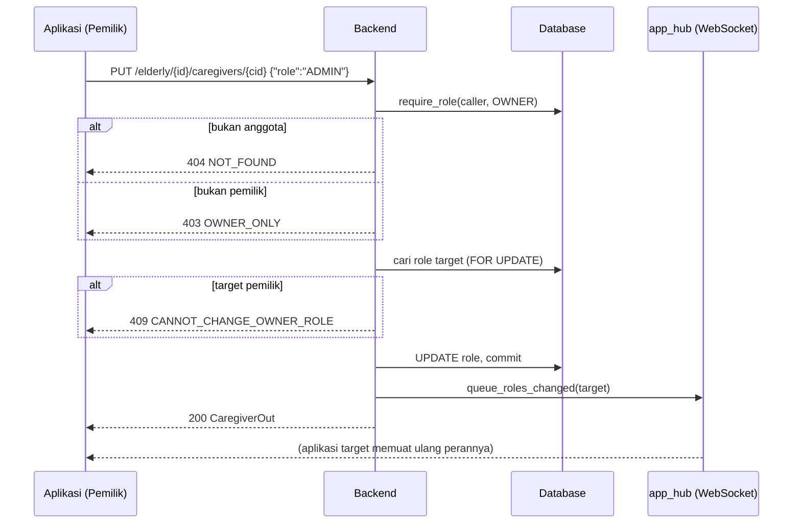
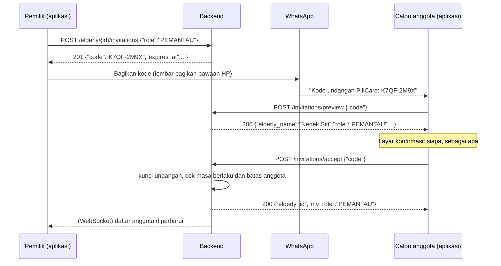

# Rencana Fitur Roles: Anggota Keluarga dan Hak Akses

**Status:** **diimplementasi** (R1 dan R2, 24 Nov 2026), keputusan D1–D6 disetujui. Belum di-commit, test backend belum dijalankan, dan API list belum diperbarui. Rincian di [Status implementasi](#status-implementasi) di bagian akhir.
**Dasar:** kode `main` per 24 Nov 2026, API list sheet *Profil_Lansia*, `docs/ai/domain.md`, dan temuan audit `docs/audits/system-audit-2026-11-24.md` (A1, A2, S1, S2).

## Isi

0. [Ringkasan dan keputusan yang diminta](#0-ringkasan-dan-keputusan-yang-diminta)
1. [Kondisi sekarang](#1-kondisi-sekarang)
2. [Belajar dari aplikasi lain](#2-belajar-dari-aplikasi-lain)
3. [Model peran](#3-model-peran)
4. [Rancangan backend](#4-rancangan-backend)
5. [Rancangan UI/UX](#5-rancangan-uiux)
6. [Rencana implementasi](#6-rencana-implementasi)
7. [Kriteria selesai](#7-kriteria-selesai)
8. [Risiko dan hal yang belum diverifikasi](#8-risiko-dan-hal-yang-belum-diverifikasi)
9. [Antrean pekerjaan berikutnya](#9-antrean-pekerjaan-berikutnya)

---

## 0. Ringkasan dan keputusan yang diminta

**Masalah utama:** backend sudah punya aturan role yang lengkap, tetapi **aplikasi tidak punya layar untuk mengelola anggota keluarga**. Caregiver tidak bisa melihat siapa saja yang memantau lansianya, tidak bisa mengundang, mengeluarkan, mengubah akses, maupun mengalihkan kepemilikan. Role ADMIN bahkan tidak bisa diberikan dari aplikasi, karena satu-satunya cara bergabung (PIN pillbox) selalu memberi role PEMANTAU.

**Usulan dalam dua fase:**

| Fase | Isi | Kontrak API | Perkiraan |
|---|---|---|---|
| **R1. Kelola anggota** | Layar Anggota memakai endpoint yang sudah ada, ditambah endpoint ubah akses dan beberapa perbaikan aturan | Tambahan 1 endpoint (tidak merusak klien lama) | Kecil–sedang |
| **R2. Undangan berkode** | Mengganti undangan lewat email dengan **kode undangan** yang dibagikan lewat WhatsApp, menunggu persetujuan penerima, dan kedaluwarsa dalam 7 hari | **Perubahan kontrak** (perlu disetujui dan dicatat di API list dan ERD) | Sedang |

R1 bisa langsung dikerjakan dan sudah menutup temuan A1 dan A2. R2 menutup celah keamanan S1 (enumerasi email) dan S2 (orang ditambahkan tanpa persetujuan).

**Keputusan yang perlu diambil tim:**

| # | Pertanyaan | Rekomendasi | Alasan |
|---|---|---|---|
| D1 | Kerjakan R2 (kode undangan) atau cukup R1? | **R1 dulu, lalu R2** | R1 cepat terlihat hasilnya; R2 menyelesaikan masalah keamanan dan persetujuan |
| D2 | Bolehkah Pengelola (ADMIN) mengundang sesama Pengelola? | **Tidak**: Pengelola hanya bisa mengundang Pemantau | Prinsip *least privilege*. Ring juga membatasi pengelolaan anggota ke pemilik akun |
| D3 | Batas jumlah anggota per lansia? | **10 anggota** | Mencegah penyalahgunaan; Google Home membatasi 6 anggota per rumah |
| D4 | Masa berlaku kode undangan? | **7 hari, sekali pakai** | Ring memberi 7–14 hari |
| D5 | Gabung lewat PIN pillbox tetap ada? | **Ya**, tetap memberi Pemantau | Jalur cepat bagi keluarga yang ada di dekat pillbox |
| D6 | Label role di aplikasi | **Pemilik · Pengelola · Pemantau** | Lebih singkat daripada "Pengasuh Utama (Pemilik)" dan tidak memakai istilah teknis "Admin". Nilai di API tetap `OWNER`/`ADMIN`/`PEMANTAU` |

---

## 1. Kondisi sekarang

### 1.1 Backend (sudah ada)

| Endpoint | Akses | Perilaku |
|---|---|---|
| `POST /elderly` | Login | Pembuat profil lansia otomatis menjadi OWNER |
| `POST /elderly/{id}/caregivers` | OWNER/ADMIN | Undang lewat email. **Langsung** menambahkan role tanpa persetujuan penerima. Email belum terdaftar → `404 CAREGIVER_NOT_REGISTERED` |
| `GET /elderly/{id}/caregivers` | Semua anggota | Daftar anggota (nama, role, label hubungan, tanggal bergabung), dengan pagination |
| `DELETE /elderly/{id}/caregivers/{cid}` | OWNER, atau diri sendiri | Keluarkan anggota, atau keluar sendiri. OWNER tidak bisa dikeluarkan (`409 CANNOT_REMOVE_OWNER`) |
| `POST /elderly/{id}/transfer-ownership` | OWNER | Kepemilikan pindah; pemilik lama menjadi ADMIN |
| `POST /devices/{id}/join` | Login + PIN | Bergabung sebagai PEMANTAU |

Penegakan role terpusat di `Backend/app/services/access.py`: orang asing mendapat `404`, anggota dengan role kurang mendapat `403`.

### 1.2 Aplikasi (yang kurang)

- Tidak ada pemanggilan ke `/caregivers` maupun `/transfer-ownership`.
- Role hanya dipakai untuk menyembunyikan tombol (`canEdit`, `canUnpair` di `Mobile/lib/devices.ts`).
- Label role panjang: "Pengasuh Utama (Pemilik)", "Pengasuh (Admin)".

### 1.3 Celah di aturan backend

| Kode | Masalah |
|---|---|
| A2 | Tidak ada cara mengubah akses anggota (Pemantau → Pengelola atau sebaliknya). Harus dikeluarkan lalu diundang ulang |
| A2 | ADMIN bisa memberi role ADMIN ke orang lain, tetapi tidak bisa mengeluarkan siapa pun |
| S1 | Undangan email membocorkan email mana yang terdaftar (`404` vs `201`), tanpa batas percobaan |
| S2 | Undangan langsung menambahkan orang tanpa persetujuannya |
| — | Tidak ada batas jumlah anggota |

Satu kabar baik: tabel `invitations` sejak awal sudah punya status `PENDING`, `ACCEPTED`, `DECLINED`, dan `REVOKED`. Hanya saja kode selalu langsung mengisi `ACCEPTED`. Alur undangan yang menunggu persetujuan tinggal dihidupkan.

---

## 2. Belajar dari aplikasi lain

| Aplikasi | Pola | Yang kita ambil |
|---|---|---|
| **Medisafe** (Medfriend) | Pengguna mengundang "Medfriend" lewat email; undangan memuat **kode 4 digit** yang dimasukkan penerima di aplikasi. Medfriend hanya bisa melihat jadwal dan kepatuhan, tidak bisa menandai dosis atau mengubah obat, dan diberi tahu bila dosis terlewat | Kode undangan; Pemantau = hanya melihat dan tetap menerima peringatan dosis terlewat |
| **Google Home** | Peran Admin dan Member, dengan label "Owner" pada pembuat rumah. Undangan muncul di kotak masuk penerima, lalu diterima atau ditolak. Batas 6 anggota per rumah | Lencana "Pemilik"; penerima harus menyetujui; batas anggota |
| **Ring** | Hanya pemilik akun yang bisa menambah, mengubah, atau mengeluarkan pengguna bersama. Undangan berlaku terbatas (7–14 hari) dan bisa dikirim ulang. Perubahan hak berlaku langsung tanpa undangan baru | Undangan kedaluwarsa; ubah akses berlaku seketika; pengelolaan anggota terpusat di pemilik |

Prinsip UI yang dipakai dari ketiganya:
1. **Satu layar "Anggota"** berisi daftar orang dengan lencana peran, bukan tabel izin.
2. **Peran dijelaskan dengan satu baris**, bukan paragraf. Detail lengkap hanya muncul saat diminta.
3. **Aksi berbahaya** (keluarkan, alihkan kepemilikan) tersembunyi di menu per orang dan selalu dikonfirmasi.
4. **Undangan menunggu persetujuan penerima**, dengan masa berlaku yang jelas.

---

## 3. Model peran

### 3.1 Nama dan arti

| API | Label | Ikon | Penjelasan satu baris |
|---|---|---|---|
| `OWNER` | **Pemilik** | bintang | Mengatur semuanya, termasuk anggota dan pillbox |
| `ADMIN` | **Pengelola** | perisai | Mengatur jadwal obat dan alarm |
| `PEMANTAU` | **Pemantau** | mata | Melihat dan menerima peringatan |

### 3.2 Matriks hak (sesudah perubahan)

| Aksi | Pemilik | Pengelola | Pemantau |
|---|:---:|:---:|:---:|
| Melihat beranda, jadwal, jurnal, notifikasi | ✓ | ✓ | ✓ |
| Menerima peringatan dosis terlewat | ✓ | ✓ | ✓ |
| Mengatur jadwal, alarm, isi ulang, kalibrasi jam | ✓ | ✓ | ✗ |
| Mengubah profil lansia | ✓ | ✓ | ✗ |
| Mengundang **Pemantau** | ✓ | ✓ | ✗ |
| Mengundang **Pengelola** | ✓ | ✗ *(baru, D2)* | ✗ |
| Mengubah akses anggota | ✓ *(baru)* | ✗ | ✗ |
| Mengeluarkan anggota | ✓ | ✗ | ✗ |
| Keluar sendiri | ✗ (alihkan dulu) | ✓ | ✓ |
| Mengalihkan kepemilikan, ganti PIN, lepas pillbox, hapus lansia | ✓ | ✗ | ✗ |

Hanya dua baris yang berubah dari aturan sekarang: Pengelola tidak lagi bisa mengundang Pengelola, dan Pemilik mendapat aksi baru untuk mengubah akses.

---

## 4. Rancangan backend

### 4.1 Fase R1: perbaikan tanpa mengubah kontrak yang ada

| # | Perubahan | Detail | File |
|---|---|---|---|
| R1.1 | **Endpoint ubah akses** | `PUT /elderly/{id}/caregivers/{caregiver_id}` body `{"role": "ADMIN" \| "PEMANTAU"}`. Hanya OWNER. Target tidak boleh OWNER (`409 CANNOT_CHANGE_OWNER_ROLE`; untuk itu pakai alih kepemilikan). Target tidak ada → `404 CAREGIVER_NOT_FOUND`. Respons `200` = `CaregiverOut`. Memanggil `queue_roles_changed` agar aplikasi target langsung memperbarui | `services/elderly.py`, `api/routes/elderly.py`, `schemas/elderly.py` |
| R1.2 | **Pengelola hanya mengundang Pemantau** (jika D2 disetujui) | ADMIN yang mengundang dengan `role: ADMIN` mendapat `403 FORBIDDEN` | `services/elderly.py` `invite()` |
| R1.3 | **Batas percobaan undangan** | Pakai `attempt_counters` dengan scope baru `CAREGIVER_INVITE`, per pengundang (misalnya 20 per jam), `429 TOO_MANY_ATTEMPTS`. Ini mempersempit celah enumerasi S1 sambil menunggu R2 | `services/elderly.py`, `models/enums.py`, migrasi `0010` |
| R1.4 | **Batas anggota** (jika D3 disetujui) | `409 MEMBER_LIMIT_REACHED` saat undangan atau *join* PIN melebihi batas | `services/elderly.py`, `services/device_management.py` `join()` |
| R1.5 | **Alih kepemilikan memberi tahu aplikasi** | Panggil `queue_roles_changed` untuk kedua pihak, supaya tampilan role berubah tanpa memuat ulang | `services/elderly.py` `transfer_ownership()` |
| R1.6 | **Pengaturan baru** | `CAREGIVER_INVITE_MAX_ATTEMPTS`, `CAREGIVER_INVITE_WINDOW_SECONDS`, `MAX_CAREGIVERS_PER_ELDERLY` di `config.py` dan `.env.example` (aturan project: tidak ada nilai yang ditulis langsung di kode) | `core/config.py`, `.env.example` |

**Migrasi `0010_caregiver_invite_limits.sql`** (R1): perluas `CHECK` pada `attempt_counters.scope` dengan `CAREGIVER_INVITE`. Hanya menambah nilai, tidak menghapus data.

**Alur ubah akses:**



### 4.2 Fase R2: undangan berkode (perubahan kontrak)

**Ide:** pengundang tidak perlu mengetik email. Aplikasi membuat **kode undangan** (contoh `K7QF-2M9X`) yang dibagikan lewat WhatsApp. Penerima memasukkan kode itu di aplikasinya, melihat ringkasan undangan, lalu menekan **Gabung**.

Masalah yang terselesaikan sekaligus:
- **S1 (enumerasi email):** tidak ada lagi pertanyaan "apakah email ini terdaftar?".
- **S2 (tanpa persetujuan):** penerima sendiri yang memutuskan untuk bergabung.
- **S3 (email tanpa verifikasi):** undangan tidak bergantung pada kepemilikan email.
- Bisa dipakai untuk orang yang **belum punya akun**: mereka mendaftar dulu, lalu memasukkan kode.

**Endpoint baru:**

| Method dan path | Akses | Body | Respons | Error |
|---|---|---|---|---|
| `POST /elderly/{id}/invitations` | OWNER/ADMIN (ADMIN hanya `PEMANTAU`) | `{"role", "relationship_label"?}` | `201 {"invitation_id", "code", "role", "relationship_label", "expires_at"}`. **Kode hanya dikembalikan sekali** | `403 FORBIDDEN`, `409 MEMBER_LIMIT_REACHED`, `429 TOO_MANY_ATTEMPTS` |
| `GET /elderly/{id}/invitations` | OWNER/ADMIN | — | Daftar undangan `PENDING` yang belum kedaluwarsa (tanpa kode) | `403`, `404` |
| `DELETE /elderly/{id}/invitations/{invitation_id}` | OWNER, atau ADMIN pembuatnya | — | `204`; status menjadi `REVOKED` | `403`, `404` |
| `POST /invitations/preview` | Login | `{"code"}` | `200 {"elderly_name", "invited_by_name", "role", "relationship_label", "expires_at"}` | `404 INVITATION_INVALID` (salah, kedaluwarsa, sudah dipakai, atau dicabut: **satu kode error untuk semua**), `409 ALREADY_CAREGIVER`, `429` |
| `POST /invitations/accept` | Login | `{"code"}` | `200 {"elderly_id", "my_role"}`; status menjadi `ACCEPTED` | Sama dengan preview, plus `409 MEMBER_LIMIT_REACHED` |

**Format dan keamanan kode:**
- 8 karakter dari alfabet tanpa huruf yang mudah tertukar (tanpa `0/O`, `1/I/L`), ditampilkan `XXXX-XXXX`. Sekitar 40 bit entropi.
- Disimpan sebagai **hash SHA-256**, bukan teks asli (pola yang sama dengan device key).
- `preview` dan `accept` dibatasi per user (scope `INVITE_CODE`, misalnya 10 per 15 menit) sehingga kode tidak bisa ditebak.
- Sekali pakai, kedaluwarsa 7 hari (`INVITATION_TTL_DAYS`).
- Proses `accept` mengunci baris undangan (`FOR UPDATE`) supaya dua orang tidak bisa memakai kode yang sama bersamaan.

**Alur undangan berkode:**



**Migrasi `0011_invitation_codes.sql`** (R2):
- `invitations.invitee_email` boleh `NULL` (undangan berkode tidak butuh email).
- Kolom baru `code_hash VARCHAR(64)` dengan indeks unik parsial `WHERE code_hash IS NOT NULL`.
- Kolom baru `expires_at TIMESTAMPTZ`.
- Indeks `(elderly_id) WHERE status = 'PENDING'` untuk daftar undangan.
- `CHECK` scope `attempt_counters` ditambah `INVITE_CODE`.

Semuanya hanya menambah atau melonggarkan, tidak menghapus data. Ikuti `docs/ai/procedures/new-migration.md` dan jalankan agent `migration-guard` sebelum diterapkan.

**Nasib `POST /elderly/{id}/caregivers` (undangan email):** dipertahankan selama aplikasi lama masih memakainya. Setelah aplikasi beralih ke kode undangan, endpoint ini dihapus dalam commit `feat(api)!`. Perubahan ini harus dicatat di API list dan ERD pada PR yang sama.

---

## 5. Rancangan UI/UX

### 5.1 Prinsip

- **Sedikit teks, banyak isyarat visual.** Setiap peran = ikon + satu kata. Penjelasan detail hanya di lembar "Apa bedanya?".
- **Satu tugas per layar.** Mengundang adalah alur dua langkah yang jelas, bukan formulir panjang.
- **Tampilkan hanya yang bisa dilakukan.** Pemantau tidak melihat tombol undang; sebagai gantinya ada lencana kecil "Hanya lihat".
- **Aksi berbahaya selalu dikonfirmasi**, dengan akibatnya ditulis dalam satu kalimat.
- **Aksesibel:** target sentuh minimal 44 pt, kontras sesuai token, dan setiap baris punya label pembaca layar.

### 5.2 Peta navigasi

```
Tab Pengaturan
 └─ Kartu "Anggota keluarga"  (tumpukan avatar + "4 anggota")
      └─ Layar Anggota  (src/app/elderly/[id]/members.tsx)
           ├─ Baris anggota → lembar aksi (Pemilik saja)
           │     ├─ Ubah akses
           │     ├─ Jadikan pemilik
           │     └─ Keluarkan
           ├─ Undangan tertunda → Bagikan lagi · Batalkan
           ├─ Tombol "Undang anggota" → alur 2 langkah
           └─ Tautan "Apa bedanya?" → lembar penjelasan peran

Beranda (belum punya lansia) / kartu Hubungkan Pillbox
 └─ "Punya kode undangan?" → Masukkan kode → Konfirmasi → Gabung
```

### 5.3 Layar Anggota

```
┌──────────────────────────────────────┐
│ ←  Anggota keluarga                  │
│    Nenek Siti                        │
├──────────────────────────────────────┤
│ (BS)  Budi Santoso · Anda        ★   │
│       Anak                  Pemilik  │
│ (RA)  Rina Ayu               🛡  ⋯   │
│       Cucu               Pengelola   │
│ (DW)  Dewi                   👁  ⋯   │
│       Perawat             Pemantau   │
├──────────────────────────────────────┤
│ MENUNGGU                             │
│ (⏳)  Pemantau · berakhir 5 hari  ⋯  │
├──────────────────────────────────────┤
│ Apa bedanya?                       › │
│                                      │
│  [  ＋  Undang anggota            ]  │
└──────────────────────────────────────┘
```

- Baris memakai `ListRow` + `Avatar` + `StatusPill` (lencana peran).
- Tombol `⋯` hanya muncul bila pengguna boleh melakukan sesuatu terhadap anggota itu.
- Pemantau melihat daftar yang sama tanpa tombol undang. Di bagian bawahnya hanya ada "Keluar dari pemantauan".

### 5.4 Lembar aksi anggota (khusus Pemilik)

```
┌──────────────────────────────────────┐
│ Rina Ayu · Pengelola                 │
│                                      │
│ Akses                                │
│ [ 🛡 Pengelola ][ 👁 Pemantau ]      │  ← SegmentedChoice, langsung tersimpan
│                                      │
│ ★  Jadikan pemilik                 › │
│ ⨯  Keluarkan                       › │  ← warna bahaya
└──────────────────────────────────────┘
```

Konfirmasi memakai `ConfirmDialog` yang sudah ada:
- **Jadikan pemilik:** "Rina menjadi Pemilik. Anda menjadi Pengelola." → [Batal] [Alihkan]
- **Keluarkan:** "Rina tidak bisa melihat data Nenek Siti lagi." → [Batal] [Keluarkan]

### 5.5 Alur undang (2 langkah)

```
Langkah 1: pilih akses                 Langkah 2: bagikan kode
┌──────────────────────────────┐      ┌──────────────────────────────┐
│ Undang anggota               │      │ Kode undangan                │
│                              │      │                              │
│ ┌──────────────────────────┐ │      │        K7QF-2M9X             │
│ │ 🛡 Pengelola             │ │      │   Berlaku 7 hari · 1 kali    │
│ │ Atur jadwal & alarm      │ │      │                              │
│ └──────────────────────────┘ │      │ [  Bagikan lewat WhatsApp  ] │
│ ┌──────────────────────────┐ │      │ [  Bagikan lainnya…        ] │
│ │ 👁 Pemantau     ✓        │ │      │                              │
│ │ Lihat & terima peringatan│ │      │ Minta penerima membuka       │
│ └──────────────────────────┘ │      │ PillCare → "Punya kode?"     │
│                              │      │                              │
│ Hubungan (opsional)          │      │ [ Selesai ]                  │
│ (Anak)(Cucu)(Pasangan)(Perawat)     └──────────────────────────────┘
│                              │
│ [ Buat kode ]                │
└──────────────────────────────┘
```

- Pengelola hanya melihat kartu Pemantau (D2).
- Label hubungan berupa `Chip`, bukan isian teks bebas.
- Bagikan memakai API `Share` bawaan React Native (tanpa paket baru). Pesan yang dibagikan: "Gabung memantau Nenek Siti di PillCare. Kode: K7QF-2M9X (berlaku 7 hari)".
- **Fase R1** (sebelum ada kode): langkah 2 diganti satu isian email. Hasilnya langsung menambahkan anggota, sesuai kontrak saat ini.

### 5.6 Alur menerima undangan (Fase R2)

```
┌──────────────────────────────┐      ┌──────────────────────────────┐
│ Masukkan kode undangan       │      │ (foto/inisial)  Nenek Siti   │
│                              │      │                              │
│  [K][7][Q][F] - [2][M][9][X] │  →   │ Budi mengundang Anda sebagai │
│                              │      │ 👁 Pemantau                  │
│ [ Lanjut ]                   │      │                              │
└──────────────────────────────┘      │ [ Gabung ]   [ Tidak ]       │
                                      └──────────────────────────────┘
```

Pesan error dibuat singkat dan bisa ditindaklanjuti:

| Kode | Pesan |
|---|---|
| `INVITATION_INVALID` | "Kode tidak berlaku. Minta kode baru ke pengirim." |
| `ALREADY_CAREGIVER` | "Anda sudah menjadi anggota." (lalu buka profil lansianya) |
| `MEMBER_LIMIT_REACHED` | "Anggota sudah penuh." |
| `TOO_MANY_ATTEMPTS` | "Terlalu banyak percobaan. Coba lagi sebentar lagi." (pesan ini sudah ada) |

### 5.7 Lembar "Apa bedanya?"

```
┌──────────────────────────────────────┐
│                ★     🛡     👁        │
│ Lihat & peringatan   ✓     ✓     ✓   │
│ Atur jadwal & alarm  ✓     ✓     –   │
│ Undang anggota       ✓     ✓*    –   │
│ Kelola anggota       ✓     –     –   │
│ Hapus & lepas alat   ✓     –     –   │
│ * hanya sebagai Pemantau             │
└──────────────────────────────────────┘
```

### 5.8 Perubahan kecil di layar lain

| Layar | Perubahan |
|---|---|
| Tab Pengaturan | Kartu "Anggota keluarga" dengan tumpukan avatar dan jumlah anggota |
| Tab Jadwal dan Pillbox (Pemantau) | Lencana kecil "👁 Hanya lihat" di header, menggantikan tombol yang dinonaktifkan |
| Daftar pillbox | Label peran memakai label baru (D6) |
| Hubungkan pillbox | Tautan "Punya kode undangan?" (R2) |

---

## 6. Rencana implementasi

### 6.1 Backend

| Urutan | Commit | Isi | Test |
|---|---|---|---|
| 1 | `feat(db): allow caregiver invite attempts in attempt counters` | Migrasi `0010` | Migrasi berjalan pada database uji |
| 2 | `feat(backend): change a caregiver's role and limit invites` | R1.1–R1.6 | Pemilik mengubah akses (`200`); Pengelola mencoba (`403`); orang asing (`404`); target pemilik (`409`); Pengelola mengundang Pengelola (`403`); batas percobaan (`429`); batas anggota (`409`); push WebSocket ke target |
| 3 | `docs(api): record the role change endpoint and invite limits` | API list dan `docs/ai/domain.md` | — |
| 4 *(R2)* | `feat(db): add invitation codes and expiry` | Migrasi `0011` | Migrasi berjalan |
| 5 *(R2)* | `feat(backend): invite caregivers with a one-time code` | `services/invitations.py`, route baru | Buat, pratinjau, terima, kedaluwarsa, dicabut, dipakai dua kali secara bersamaan, tebakan kode (`429`), kode salah dan kedaluwarsa memberi error yang sama |
| 6 *(R2)* | `feat(api)!: replace email invites with invitation codes` | Hapus undangan email setelah aplikasi beralih; API list dan ERD diperbarui | Test lama disesuaikan |

### 6.2 Mobile

| Urutan | Commit | File |
|---|---|---|
| 1 | `feat(mobile): add the caregiver members data layer` | `lib/members.ts` (daftar, undang, keluarkan, ubah akses, alihkan), `src/hooks/use-members.ts`, tipe yang sama persis dengan API list |
| 2 | `feat(mobile): add the members screen` | `src/app/elderly/[id]/members.tsx`, `src/components/members/member-row.tsx`, `role-badge.tsx`, `member-actions-sheet.tsx`, `role-info-sheet.tsx` |
| 3 | `feat(mobile): add the invite flow` | `src/components/members/invite-sheet.tsx` (R1: email; R2: kode + bagikan) |
| 4 | `feat(mobile): link members from settings and relabel roles` | `settings-tab.tsx` (kartu anggota), `strings.ts` (label baru dan semua teks), lencana "Hanya lihat" |
| 5 *(R2)* | `feat(mobile): join an elderly profile with an invitation code` | `src/components/members/code-input.tsx`, layar konfirmasi, tautan di kartu Hubungkan Pillbox |

Aturan dari `Mobile/CLAUDE.md` yang wajib diikuti:
- Semua teks di `src/constants/strings.ts`.
- Warna dari token, tanpa hex baru.
- Daftar memakai `FlatList` dengan baris yang di-*memo*.
- Layar tipis: logika di hook.
- Tidak membuka WebSocket kedua; perubahan peran sudah didorong lewat `/ws/app`.

---

## 7. Kriteria selesai

**Fase R1:**
- [ ] Pemilik bisa melihat semua anggota, mengundang (Pengelola atau Pemantau), mengubah akses, mengeluarkan, dan mengalihkan kepemilikan dari aplikasi.
- [ ] Pengelola bisa melihat anggota dan mengundang Pemantau, tetapi tidak bisa mengelola anggota lain.
- [ ] Pemantau hanya melihat daftar anggota dan bisa keluar sendiri.
- [ ] Perubahan peran langsung terlihat di HP anggota yang bersangkutan tanpa memuat ulang manual.
- [ ] Semua aksi tetap ditolak backend bila dicoba lewat Postman dengan peran yang salah (`403`/`404`).
- [ ] Test backend baru lulus, dan API list sudah diperbarui.

**Fase R2:**
- [ ] Undangan tidak pernah menambahkan orang tanpa ia menekan **Gabung**.
- [ ] Respons tidak membedakan kode salah, kedaluwarsa, sudah dipakai, atau dicabut.
- [ ] Kode tidak bisa ditebak (batas percobaan aktif) dan tidak tersimpan sebagai teks asli.
- [ ] Orang tanpa akun bisa mendaftar lalu bergabung memakai kode.

---

## 8. Risiko dan hal yang belum diverifikasi

| Risiko | Mitigasi |
|---|---|
| R2 mengubah kontrak yang dipakai bersama | Ajukan di API list dulu; pertahankan endpoint lama sampai aplikasi beralih |
| Migrasi di database bersama | Uji di database lokal; jalankan `migration-guard`; terapkan lewat `scripts.migrate`, jangan manual |
| Bagikan di web: `Share` React Native bergantung pada dukungan `navigator.share` di browser | Sediakan teks kode yang bisa dipilih dan disalin manual sebagai cadangan. Menambah `expo-clipboard` butuh persetujuan tim karena paket baru |
| Kode bocor ke orang yang salah | Masa berlaku 7 hari, sekali pakai, bisa dicabut, dan Pemilik melihat siapa yang bergabung |
| Belum diverifikasi | Perilaku `Share` di web dan Android belum dicoba. Batas 20 undangan per jam dan 10 anggota adalah usulan, bukan hasil pengukuran |

---

## 9. Antrean pekerjaan berikutnya

Dua permintaan lain dicatat di sini dan akan dirancang **setelah** rencana ini disetujui:

1. **Aplikasi tetap bisa dipakai saat pillbox mati.** Beranda, jadwal, jurnal, notifikasi, dan pengaturan harus tetap terbuka saat pillbox offline atau backend sulit dijangkau, dengan penanda status yang jelas, bukan layar error. Perlu dianalisis dulu layar mana yang saat ini memblokir.
2. **Perbaikan UI/UX menyeluruh.** Audit setiap layar dengan heuristik usability (Nielsen), panduan Material dan iOS, serta aksesibilitas, lalu sederhanakan teks dan alur supaya terasa seperti aplikasi mobile profesional.

---

## Rujukan

- Medisafe, *All about Medfriends* dan *How do I add a Medfriend*: https://help-center.medisafe.com/en/articles/8395236-all-about-medfriends, https://help-center.medisafe.com/en/articles/8097832-how-do-i-add-a-medfriend
- Google, *Manage people and permissions in the Google Home app*: https://support.google.com/googlehome/answer/9155535
- Ring, *Managing Shared Users* dan *Managing users and roles*: https://ring.com/support/articles/clv68/managing-shared-users, https://ring.com/support/articles/yzs34/managing-users-and-roles
- API list (sheet *Profil_Lansia*) dan `docs/ai/domain.md` untuk kontrak dan aturan role saat ini.

---

## Status implementasi

**Tanggal:** 24 Nov 2026. Semua perubahan ada di working tree `main`, **belum di-commit**.

### Yang dikerjakan

| Bagian | File |
|---|---|
| Migrasi `0010` (scope `CAREGIVER_INVITE`) dan `0011` (kode undangan, masa berlaku, indeks) | `Backend/migrations/0010_caregiver_invite_limits.sql`, `0011_invitation_codes.sql` |
| Aturan peran: `GRANTABLE_ROLES`, `require_grantable()`, `ensure_member_room()` | `Backend/app/services/access.py` |
| Ubah akses, batas undangan, batas anggota, pemberitahuan saat alih kepemilikan | `Backend/app/services/elderly.py`, `device_management.py` (`join`) |
| Undangan berkode: buat, daftar, cabut, pratinjau, terima | `Backend/app/services/invitations.py`, `api/routes/invitations.py`, `api/routes/elderly.py` |
| Pesan WebSocket `{"type": "roles"}` setelah peran berubah | `Backend/app/services/app_hub.py` |
| Pengaturan baru | `Backend/app/core/config.py`, `Backend/.env.example` |
| Test (12 kasus) | `Backend/tests/test_caregivers.py` |
| Lapisan data dan hook | `Mobile/lib/members.ts`, `src/hooks/use-members.ts`, `src/hooks/use-member-actions.ts` |
| Layar Anggota dan dialog | `Mobile/src/app/elderly/[id]/members.tsx`, `src/components/members/*` |
| Pintu masuk | Pengaturan (kartu Anggota + "Punya kode undangan?"), layar Hubungkan Pillbox, lencana "Hanya lihat" di tab Jadwal |
| Label peran baru (D6) dan semua teks | `Mobile/src/constants/strings.ts` |
| Penanganan pesan `roles` | `Mobile/lib/api.ts`, `context/devices-context.tsx` |

### Penyimpangan dari rencana

| Rencana | Yang dibuat | Alasan |
|---|---|---|
| Hapus undangan email (`feat(api)!`) setelah aplikasi beralih | Endpoint **dipertahankan**, ditandai `deprecated` di OpenAPI, dan ikut aturan baru (batas peran, batas percobaan, batas anggota) | Menghapus endpoint adalah perubahan kontrak yang merusak (*breaking*) dan butuh pembaruan API list lebih dulu |
| Lembar (*bottom sheet*) untuk aksi | `Dialog` yang sudah ada | Aplikasi belum punya komponen lembar; `Dialog` sudah berjalan sama di Android, iOS, dan web |
| Isian kode 8 kotak | Satu isian yang otomatis memformat `XXXX-XXXX` | Lebih mudah ditempel dari WhatsApp |
| — | Tambahan `invited_by_user_id` di daftar undangan | Pengelola perlu tahu undangan mana yang boleh ia batalkan (miliknya sendiri) |
| — | Tambahan pesan WebSocket `roles` | Supaya perubahan peran langsung terlihat (kriteria selesai di bagian 7) |

### Verifikasi

| Pemeriksaan | Hasil |
|---|---|
| TypeScript (`tsc --noEmit`, seluruh Mobile) | Lulus |
| ESLint pada semua file Mobile yang diubah | Lulus |
| Backend: import app, kompilasi, OpenAPI | 63 operasi (57 lama + 6 baru), 12 test terkumpul |
| **Test backend (`pytest`)** | **Belum dijalankan**: tidak ada PostgreSQL uji di komputer ini |
| Migrasi `0010`–`0011` | Diterapkan ke database bersama Supabase pada 24 Nov 2026 (15.13 WIB) dan diperiksa: kolom, indeks, dan CHECK scope sesuai |
| Uji alur end-to-end lewat API (24 Nov, Backend dan server auth lokal, database bersama) | **44/44 cek lulus**, lalu **54/54** setelah perbaikan review (12 cek tambahan: kode mati saat pengundang diturunkan, dikeluarkan, atau setelah alih kepemilikan; profil tanpa pillbox muncul di `GET /elderly`): undangan berkode (buat, pratinjau, terima, sekali pakai, kode salah dan dibatalkan dijawab sama `404 INVITATION_INVALID`, kode tidak pernah dikembalikan di daftar), Pengelola hanya memberi Pemantau (juga lewat undangan email lama), batal undangan (Pengelola hanya miliknya), Pemantau tidak bisa mengundang atau mengubah akses, ubah akses + push `{"type":"roles"}` diterima lewat `/ws/app`, peran OWNER tidak bisa diubah, keluar sendiri, alih kepemilikan, batas tebakan kode `429`. Akun dan profil uji dihapus setelahnya |
| Belum diuji end-to-end | Batas 10 anggota, batas 20 undangan per jam, kode kedaluwarsa (ketiganya hanya di test `pytest` yang belum dijalankan), dan tampilan aplikasi |

### Perbaikan setelah review kode (24 Nov 2026)

| Temuan | Perbaikan |
|---|---|
| Kode undangan tetap berlaku setelah pengundang diturunkan, dikeluarkan, atau keluar | Undangan tertunda yang tidak bisa lagi diberikan pengundang dibatalkan saat perubahan terjadi (`revoke_invitations_beyond` di `services/elderly.py`), dan `services/invitations.py` menolak kode yang pengundangnya tidak lagi berhak (termasuk akun yang dihapus). Test baru: `test_codes_die_when_the_inviter_loses_the_right` |
| Profil tanpa pillbox tidak bisa dibuka setelah bergabung | Setelah bergabung, aplikasi membuka layar Anggota profil itu. Kartu "Profil tanpa pillbox" (Pengaturan dan layar Hubungkan Pillbox) memakai `GET /elderly` |
| Pesan "keluar" dan "bergabung" tidak terlihat | Layar Anggota menampilkan keadaan "Anda keluar" dan pesan bergabung saat dibuka |
| Layar Anggota tidak berubah saat dikeluarkan | `404` menampilkan "Anda bukan anggota lagi"; galat muat ulang tampil di atas daftar |
| Kode yang ditempel bersama teks terpotong | Kode `XXXX-XXXX` diambil dari teks yang ditempel; batas panjang isian dihapus |
| Batas anggota bisa terlewati bersamaan | `ensure_member_room` mengunci baris lansia sebelum menghitung |
| Teks mode contoh ditulis dua kali | `requireBackend()` bersama di `lib/elderly.ts`, memakai `Strings.apiErrors` |
| Endpoint dan kode error baru belum di API list dan ERD | **API list diperbarui 24 Nov 2026**: sheet *Profil_Lansia* (baris baru `PUT /caregivers/{id}` dan 5 baris undangan; undangan email ditandai deprecated dengan error baru), *PerangkatPillbox* (`join`: `409 MEMBER_LIMIT_REACHED`), *Realtime* (pesan `roles`). **ERD belum**: dbdiagram.io tidak bisa diubah dari sini, tempel DBML di bawah secara manual |

### Perubahan ERD (tempel ke dbdiagram.io)

Ganti tabel `invitations` dengan ini (migrasi `0011`):

```dbml
Table invitations {
  id uuid [pk, default: `gen_random_uuid()`]
  elderly_id uuid [not null, ref: > elderly.id]
  invited_by_user_id uuid [ref: > users.id]
  invitee_email varchar(254) [note: 'NULL untuk undangan berkode']
  invitee_user_id uuid [ref: > users.id]
  role varchar(10) [not null, note: 'ADMIN | PEMANTAU']
  relationship_label varchar(50)
  status varchar(10) [not null, default: 'PENDING', note: 'PENDING | ACCEPTED | DECLINED | REVOKED']
  created_at timestamptz [not null, default: `now()`]
  responded_at timestamptz
  code_hash varchar(64) [unique, note: 'SHA-256 dari kode sekali pakai yang dinormalisasi; kode aslinya tidak disimpan']
  expires_at timestamptz [note: 'wajib bila code_hash terisi']

  indexes {
    (elderly_id, created_at) [name: 'invitations_pending_idx', note: 'WHERE status = PENDING']
  }
  Note: 'Setiap baris punya invitee_email atau code_hash'
}
```

Tabel baru `device_mutes` (migrasi `0012`, P1 item 6) dan kolom baru di `push_tokens` (Prisma `20261124000000_push_token_session`):

```dbml
Table device_mutes {
  id uuid [pk, default: `gen_random_uuid()`]
  user_id uuid [not null, ref: > users.id]
  device_id uuid [not null, ref: > devices.id]
  created_at timestamptz [not null, default: `now()`]

  indexes {
    (user_id, device_id) [unique, name: 'device_mutes_user_device_key']
    device_id [name: 'device_mutes_device_idx']
  }
  Note: 'Caregiver berhenti mengikuti satu pillbox; perannya di profil lansia tetap'
}

// Tambahkan ke Table push_tokens:
//   refresh_family_id uuid [note: 'Sesi (refresh_tokens.family_id) saat HP didaftarkan; logout menghapus token ini']
```

Header ERD saat ini masih menyebut commit `341e9bd` (17 Okt 2026); ganti menjadi tanggal pembaruan.

Bila `attempt_counters` ada di ERD, nilai `scope` kini: `DEVICE_PIN | DEVICE_PIN_JOIN | PAIRING_SCAN | CAREGIVER_INVITE | INVITE_CODE` (migrasi `0010`–`0011`).

### Langkah sebelum dipakai

1. Jalankan test backend dengan database uji lokal: `uv run pytest tests/test_caregivers.py`, lalu seluruh suite.
2. ~~Terapkan migrasi ke database bersama~~: sudah, 24 Nov 2026. Beri tahu tim bahwa database bersama kini memuat `0010`–`0011`.
3. ~~Tambahkan baris ke API list~~: sudah, 24 Nov 2026. ERD: tempel DBML di atas ke dbdiagram.io.
4. Tambahkan 6 request baru ke koleksi Postman.

### Baris API list yang perlu ditambahkan

| Functionality | Endpoint | Akses | Request | Response | Errors |
|---|---|---|---|---|---|
| Mengubah akses caregiver | `PUT /elderly/{elderly_id}/caregivers/{caregiver_id}` | OWNER | `{ "role": "ADMIN \| PEMANTAU" }` | Sama dengan item daftar caregiver | `403 OWNER_ONLY`, `404 CAREGIVER_NOT_FOUND`, `409 CANNOT_CHANGE_OWNER_ROLE` |
| Membuat kode undangan | `POST /elderly/{elderly_id}/invitations` | OWNER / ADMIN (ADMIN hanya `PEMANTAU`) | `{ "role", "relationship_label"? }` | `{ invitation_id, code, role, relationship_label, expires_at }` | `403 FORBIDDEN`, `409 MEMBER_LIMIT_REACHED`, `429 TOO_MANY_ATTEMPTS` |
| Melihat undangan tertunda | `GET /elderly/{elderly_id}/invitations?page&limit` | OWNER / ADMIN | — | `{ data: [{ invitation_id, role, relationship_label, invited_by_user_id, invited_by_name, created_at, expires_at }], page, limit, total }` | `403 FORBIDDEN`, `404 NOT_FOUND` |
| Membatalkan undangan | `DELETE /elderly/{elderly_id}/invitations/{invitation_id}` | OWNER, atau ADMIN pembuatnya | — | `204` | `403 FORBIDDEN`, `404 INVITATION_NOT_FOUND` |
| Pratinjau kode undangan | `POST /invitations/preview` | Caregiver | `{ "code" }` | `{ elderly_name, invited_by_name, role, relationship_label, expires_at }` | `404 INVITATION_INVALID`, `409 ALREADY_CAREGIVER`, `429 TOO_MANY_ATTEMPTS` |
| Menerima kode undangan | `POST /invitations/accept` | Caregiver | `{ "code" }` | `{ elderly_id, my_role }` | Sama dengan pratinjau, plus `409 MEMBER_LIMIT_REACHED` |
| *(perubahan)* Undang lewat email | `POST /elderly/{elderly_id}/caregivers` | OWNER / ADMIN (ADMIN hanya `PEMANTAU`) | tetap | tetap | tambahan `409 MEMBER_LIMIT_REACHED`, `429 TOO_MANY_ATTEMPTS`; ditandai *deprecated* |
| *(perubahan)* Gabung lewat PIN | `POST /devices/{device_id}/join` | Caregiver | tetap | tetap | tambahan `409 MEMBER_LIMIT_REACHED` |
| *(Realtime)* Peran berubah | WS `/ws/app` server → app | — | — | `{ "type": "roles" }` | — |
