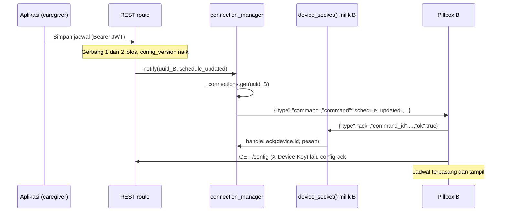

# WebSocket di PillCare: dari Handshake sampai Perintah ke Pillbox

Dokumen ini menjelaskan, langkah demi langkah, bagaimana backend dan pillbox terhubung lewat WebSocket, bagaimana backend membedakan banyak pillbox, dan bagaimana sebuah perintah sampai ke pillbox lalu dikonfirmasi.

## Cara membaca dokumen

- Setiap bagian berisi **penjelasan**, **analogi** (kotak kutipan), dan **kode** lengkap dengan lokasi file dan nomor baris.
- **Nomor baris diambil dari commit `f40b196` dan masih berlaku sampai `main` per 24 Nov 2026 (`f5a85cd`)**: sejak `f40b196` tidak ada perubahan di `Backend/` maupun `SmartDevice/`. Nomor baris bergeser jika file-file itu berubah lagi. Branch lama `backend/connect-pillbox` (`d98ca74`) tidak memuat kode ini.
- Isi dokumen disusun dari pembacaan kode. **Koneksinya tidak dijalankan saat dokumen ditulis.** Satu hal yang tidak diverifikasi tertulis di bagian 2.

## Daftar isi

1. [Gambaran besar](#1-gambaran-besar)
2. [Langkah 0: apa itu WebSocket (protokol)](#2-langkah-0-apa-itu-websocket-protokol)
3. [Langkah 1: pillbox membuka koneksi](#3-langkah-1-pillbox-membuka-koneksi)
4. [Langkah 2: server menerima dan menyelesaikan upgrade](#4-langkah-2-server-menerima-dan-menyelesaikan-upgrade)
5. [Langkah 3: backend mengenali pillbox mana ini](#5-langkah-3-backend-mengenali-pillbox-mana-ini)
6. [Langkah 4: koneksi disimpan](#6-langkah-4-koneksi-disimpan)
7. [Langkah 5: sapaan awal dan loop pesan](#7-langkah-5-sapaan-awal-dan-loop-pesan)
8. [Langkah 6: backend mengirim perintah](#8-langkah-6-backend-mengirim-perintah)
9. [Langkah 7: pillbox menerima, menjalankan, dan membalas](#9-langkah-7-pillbox-menerima-menjalankan-dan-membalas)
10. [Langkah 8: koneksi putus atau diganti](#10-langkah-8-koneksi-putus-atau-diganti)
11. [Banyak pillbox: bagaimana tidak tertukar](#11-banyak-pillbox-bagaimana-tidak-tertukar)
12. [Soket aplikasi (`/ws/app`) berbeda](#12-soket-aplikasi-wsapp-berbeda)
13. [Batas dan hal yang perlu diwaspadai](#13-batas-dan-hal-yang-perlu-diwaspadai)
14. [Peta file](#14-peta-file)

---

## 1. Gambaran besar

```
                 ┌────────────────────── BACKEND (satu proses uvicorn) ──────────────────────┐
 Pillbox A ─────►│ device_socket() #1 ─┐                                                      │
 Pillbox B ─────►│ device_socket() #2 ─┼──► connection_manager._connections                   │
 Pillbox C ─────►│ device_socket() #3 ─┘     { uuid_A → konek A, uuid_B → konek B, ... }     │
                 │                                                                            │
 App user 1 ────►│ app_socket() ───────┬──► app_hub  (indeks per user dan per lansia)         │
 App user 2 ────►│ app_socket() ───────┘                                                      │
                 └────────────────────────────────────────────────────────────────────────────┘
```

Tiga fakta yang menjadi inti seluruh dokumen ini:

1. **Pillbox yang menghubungi backend**, bukan sebaliknya. Backend hanya menunggu.
2. **Satu koneksi = satu salinan fungsi `device_socket()` yang sedang berjalan.** Tiga pillbox berarti tiga salinan yang berjalan bersamaan, masing-masing dengan variabel lokalnya sendiri.
3. **Soket itu sendiri tidak punya identitas.** Identitas dibuktikan aplikasi lewat kode di path ditambah `X-Device-Key`, lalu hasilnya (`device.id`) disimpan sebagai kunci di sebuah `dict` di memori.

> **Analogi: kantor dengan banyak telepon.** Setiap pillbox adalah cabang yang **menelepon** ke pusat. Telepon yang diangkat baru berupa suara anonim. Operator meminta "nama cabang dan kata sandi", mencocokkannya dengan buku data, lalu menulis di papan: "Cabang A: saluran 1, Cabang B: saluran 2". Kalau pusat ingin memberi instruksi, operator melihat papan, lalu bicara di saluran yang tepat. Pusat tidak pernah menelepon duluan.

---

## 2. Langkah 0: apa itu WebSocket (protokol)

WebSocket (RFC 6455) adalah standar internet yang memberi koneksi **dua arah, tetap terbuka**. Ia dimulai sebagai request HTTP biasa yang meminta "naik kelas":

```
Klien → Server
  GET /ws/device/PB-AAAA HTTP/1.1
  Upgrade: websocket
  Connection: Upgrade
  Sec-WebSocket-Key: <nilai acak>
  Sec-WebSocket-Version: 13
  X-Device-Key: <secret>              ← header tambahan milik PillCare

Server → Klien
  HTTP/1.1 101 Switching Protocols
  Sec-WebSocket-Accept: base64(SHA1(key + GUID tetap dari RFC))
  ── sejak titik ini TCP yang sama membawa FRAME, bukan HTTP ──
```

Setelah `101`, kedua sisi saling mengirim frame: text, binary, ping, pong, close. Frame close membawa **kode**. Rentang `4000`–`4999` disediakan standar untuk aplikasi, dan project ini memakainya:

| Kode | Arti di PillCare |
|---|---|
| `4401` | Autentikasi gagal, atau key dirotasi, atau token app kedaluwarsa |
| `4000` | Digantikan koneksi baru dengan identitas yang sama |
| `1011` | Kegagalan sisi server (standar). Klien menyambung ulang dengan backoff |

> **Analogi: telepon biasa vs walkie-talkie.** HTTP biasa seperti mengirim surat: kirim, tunggu balasan, selesai. WebSocket seperti mengangkat telepon: sekali tersambung, kedua pihak bicara kapan saja sampai ada yang menutup. `Upgrade` adalah momen "tolong sambungkan saya ke saluran suara, bukan saluran surat".

**Yang tidak diberikan WebSocket:** nama pengguna, kata sandi, atau cara membedakan klien. Itu semua harus dibuat oleh aplikasi. Bagian 5 membahasnya.

**Library yang menangani upgrade.** Ada tiga lapis, dan kode PillCare baru ikut campur di lapis ketiga:

| Lapis | Di project | Tugas |
|---|---|---|
| Server (ASGI) | **uvicorn** 0.54.0 dengan **websockets** 17.1 terpasang (`Backend/uv.lock`) | Menerima TCP, membaca request, mengirim `101` |
| Framework | **FastAPI** 0.141.1 / **Starlette** 1.7.0 | Mencocokkan path ke fungsi, membungkus koneksi sebagai object `WebSocket` |
| Kode kita | `device_socket()` di `ws.py` | Memanggil `accept()`, lalu mengurus autentikasi dan pesan |

Yang **tidak saya verifikasi**: apakah uvicorn memproses frame dengan `websockets` atau `wsproto`. Library `websockets` memang terpasang, tetapi saya belum membuktikan yang dipakai.

---

## 3. Langkah 1: pillbox membuka koneksi

Emulator memakai `QWebSocket` (PySide6). Kelas pembungkusnya adalah `DeviceSocket`.

**URL tujuan.** `SmartDevice/smart_pillbox/config.py`:

```python
139  BACKEND_ROOT_URL = os.environ.get("PILLCARE_BACKEND_URL", "http://localhost:8000").rstrip("/")
...
169  def device_ws_url(device_code: str) -> str:
170      return BACKEND_ROOT_URL.replace("http", "ws", 1) + f"/ws/device/{device_code}"
```

`http://localhost:8000` menjadi `ws://localhost:8000/ws/device/PB-AAAA`. Kode pillbox ikut menjadi bagian path.

**Membuka koneksi dan memasang key.** `SmartDevice/smart_pillbox/core/ws_client.py`:

```python
76   def _open(self) -> None:
77       if not self._wanted or self._identity is None:
78           return
79       if self._ws.state() != QAbstractSocket.SocketState.UnconnectedState:
80           return  # already connecting or connected (a stale retry must not replace it)
81       code, key = self._identity
82       request = QNetworkRequest(QUrl(config.device_ws_url(code)))
83       request.setRawHeader(b"X-Device-Key", key.encode("utf-8"))
84       self._ws.open(request)
```

Baris 82–84 adalah inti: bangun URL, tempelkan `X-Device-Key` sebagai header di request upgrade, lalu `open()`. `QWebSocket` yang melakukan handshake `101`.

**Kapan koneksi dibuka.** `SmartDevice/smart_pillbox/gui/main_window.py`:

```python
1049  def _refresh_socket(self) -> None:
1050      """Keeps the command channel open while registered and online."""
1051      code, key = self._identity
1052      if self._is_online and code and key:
1053          self._socket.start(code, key)
1054      else:
1055          self._socket.stop()
```

Soket hanya dibuka jika emulator **sudah terdaftar** (punya kode dan key) **dan** "Wi-Fi" emulator menyala. Mematikan Wi-Fi di emulator menutup soket.

> **Analogi.** Cabang hanya mengangkat telepon ke pusat kalau ia sudah punya nomor induk dan kata sandi (terdaftar), dan kabel teleponnya tersambung (online).

---

## 4. Langkah 2: server menerima dan menyelesaikan upgrade

Backend mendaftarkan fungsi untuk path itu. `Backend/app/api/routes/ws.py`:

```python
80   @router.websocket("/ws/device/{device_code}")
81   async def device_socket(websocket: WebSocket, device_code: str) -> None:
82       settings = get_settings()
83       await websocket.accept()
```

`ws.router` dipasang di `Backend/app/main.py:100` (`app.include_router(ws.router)`).

Urutan kejadiannya:

1. Uvicorn menerima request `GET ... Upgrade: websocket`, lalu menyerahkannya ke FastAPI.
2. FastAPI melihat path `/ws/device/PB-AAAA`, mencocokkannya dengan baris 80, dan **mengambil `PB-AAAA` sebagai argumen `device_code`**.
3. Fungsi `device_socket()` dipanggil dengan object `websocket`. Pada titik ini koneksi baru "diajukan", belum terbuka.
4. **Baris 83, `accept()`**, yang membuat server membalas `101`. Sebelum baris ini kita belum bisa mengirim atau menerima apa pun.

> **Analogi.** Request upgrade adalah telepon yang berdering. FastAPI adalah resepsionis yang melihat nomor tujuan dan menyambungkan ke operator yang tepat (`device_socket`). `accept()` adalah operator **mengangkat gagang**. Sebelum diangkat, tidak ada yang bisa bicara.

**Setiap koneksi menjalankan satu salinan fungsi.** Jika tiga pillbox menyambung, tiga coroutine `device_socket()` berjalan bersamaan. Masing-masing punya variabel lokal sendiri:

```
device_socket #1:  websocket=ws_A  device_code="PB-AAAA"  device=Device(A)  conn=...
device_socket #2:  websocket=ws_B  device_code="PB-BBBB"  device=Device(B)  conn=...
device_socket #3:  websocket=ws_C  device_code="PB-CCCC"  device=Device(C)  conn=...
```

Itulah alasan loop sebuah soket tidak pernah salah mengira ia melayani device lain: **identitas ada di variabel lokal salinan fungsinya sendiri.**

---

## 5. Langkah 3: backend mengenali pillbox mana ini

Setelah `accept()`, soketnya masih anonim. Fungsi `_authenticate()` yang menentukan siapa dia. `Backend/app/api/routes/ws.py`:

```python
54   async def _authenticate(websocket: WebSocket, device_code: str, timeout: float) -> Device | None:
55       key = websocket.headers.get("x-device-key")
56       if key is None:
57           try:
58               first = json.loads(await asyncio.wait_for(websocket.receive_text(), timeout=timeout))
59           except (TimeoutError, ValueError, KeyError, WebSocketDisconnect):
60               return None
61           if not isinstance(first, dict) or first.get("type") != "auth":
62               return None
63           key = first.get("device_key")
64           if not isinstance(key, str):
65               return None
66       try:
67           async with get_sessionmaker()() as session:
68               return await authenticate_device(session, device_code, key)
```

Dua cara membawa key:

| Cara | Kapan |
|---|---|
| Header `X-Device-Key` di request upgrade (baris 55) | Cara yang dipakai emulator |
| Pesan pertama `{"type":"auth","device_key":"..."}` (baris 56–65), harus tiba dalam `ws_auth_timeout_seconds` (bawaan 10 detik, `config.py:105`) | Untuk klien yang tidak bisa memasang header |

Lalu pencocokan ke database. `Backend/app/services/device_protocol.py`:

```python
39   async def find_device(session, device_ref: str, *, lock: bool = False) -> Device | None:
...
48       stmt = select(Device).where(Device.id == as_uuid) if as_uuid else select(Device).where(Device.device_code == device_ref)
...
57   async def authenticate_device(session, device_ref: str, secret: str | None, *, lock: bool = False) -> Device:
...
64       device = await find_device(session, device_ref)
65       # verify_device_secret runs in constant time and also when device is None.
66       if not verify_device_secret(secret, device.device_secret_hash if device else None) or device is None:
67           logger.warning("device_auth_failed", extra={"device_ref": device_ref})
68           raise device_key_invalid()
```

Dan perbandingan hash. `Backend/app/core/security.py`:

```python
87   def hash_device_secret(secret: str) -> str:
88       return hashlib.sha256(secret.encode("utf-8")).hexdigest()
...
96   def verify_device_secret(provided: str | None, stored_hash: str | None) -> bool:
97       candidate = hash_device_secret(provided or "")
98       expected = stored_hash or _DUMMY_SECRET_HASH
99       matches = hmac.compare_digest(candidate, expected)
100      return matches and provided is not None and stored_hash is not None
```

Jadi tiga sumber identitas bekerja sama:

| Sumber | Peran |
|---|---|
| **Kode di path** (`PB-AAAA`) | "Aku mengaku device ini" → memilih baris di tabel `devices` |
| **`X-Device-Key`** | Bukti pengakuan: `sha256(key)` harus sama dengan `device_secret_hash` di baris itu |
| **`device.id` (UUID)** | Hasil akhir yang dipakai sebagai kunci penyimpanan |

Jika gagal, kembali ke `device_socket()`:

```python
89       if device is None:
90           await websocket.close(code=WS_CLOSE_AUTH_FAILED, reason="device authentication failed")
91           return
```

Soket ditutup dengan kode `4401`. Emulator yang menerima `4401` berhenti mencoba tiap detik dan menunggu paling lama (`ws_client.py` di `_on_lost`, kode `WS_CLOSE_AUTH_FAILED`), karena key yang salah tidak akan sembuh dengan mengulang.

Device B yang mengirim key miliknya ke path device A **gagal di sini**: hash key B tidak sama dengan `device_secret_hash` milik A. Backend juga membandingkan terhadap *dummy hash* saat device tidak ada, sehingga kode terdaftar dan tidak terdaftar ditolak dalam waktu yang sama.

> **Analogi.** Operator bertanya dua hal: "Cabang mana?" (kode di path) dan "Apa kata sandinya?" (key). Ia membuka buku data, mencari baris cabang itu, lalu menghitung "sidik jari" kata sandi dan mencocokkannya. Kata sandi aslinya tidak ada di buku, hanya sidik jarinya. Kalau cocok, ia mencatat nomor induk resmi cabang itu (`device.id`).

---

## 6. Langkah 4: koneksi disimpan

Setelah lolos, soket dibungkus dalam sebuah object lalu didaftarkan. `Backend/app/api/routes/ws.py`:

```python
93       conn = DeviceConnection(device.id, device.device_code, websocket, datetime.now(UTC))
94       replaced = connection_manager.register(conn)
95       if replaced is not None:
96           await connection_manager.close_socket(replaced, WS_CLOSE_REPLACED, "replaced by a newer connection")
```

**Object-nya.** `Backend/app/services/connection_manager.py`:

```python
79   @dataclass
80   class DeviceConnection:
81       device_id: UUID
82       device_code: str
83       websocket: WebSocket
84       connected_at: datetime
85       send_lock: asyncio.Lock = field(default_factory=asyncio.Lock)
```

| Field | Gunanya |
|---|---|
| `device_id` | Identitas hasil autentikasi (UUID). Dipakai sebagai kunci penyimpanan |
| `device_code` | Label yang mudah dibaca (`PB-AAAA`) |
| `websocket` | Object soket yang dipakai untuk `send_json` dan `receive_text` |
| `connected_at` | Kapan tersambung |
| `send_lock` | Kunci agar hanya satu coroutine menulis ke soket ini pada satu waktu |

**Tempat penyimpanannya.** Masih di file yang sama:

```python
98   class ConnectionManager:
99       def __init__(self, history_size: int | None = None) -> None:
100          self._connections: dict[UUID, DeviceConnection] = {}
101          self._pending: dict[str, _Pending] = {}
...
279  connection_manager = ConnectionManager()
```

Satu objek global `connection_manager` (baris 279) menyimpan dua kamus:

| Kamus | Kunci | Nilai | Isi |
|---|---|---|---|
| `_connections` | `device.id` (UUID) | `DeviceConnection` | Soket yang sedang terbuka |
| `_pending` | `command_id` (string) | `_Pending` | Perintah yang sudah dikirim dan menunggu `ack` |

**Mendaftar dan menggantikan.**

```python
114  def register(self, conn: DeviceConnection) -> DeviceConnection | None:
...
118      previous = self._connections.get(conn.device_id)
119      self._connections[conn.device_id] = conn
120      if previous is not None:
121          self._fail_pending(conn.device_id)
122      return previous
```

Karena kunci adalah `device_id`, **hanya ada satu koneksi per device**. Jika pillbox yang sama menyambung lagi (misalnya setelah Wi-Fi putus-nyambung), entri lama ditimpa dan soket lama ditutup dengan kode `4000`. Perintah yang masih menunggu `ack` di soket lama langsung gagal (baris 121), tidak menunggu timeout, karena soket lama tidak akan pernah mengirim ack.

> **Analogi: papan operator.** Papan itu berisi satu baris per cabang: "Cabang A, saluran 1". Kalau Cabang A menelepon lagi dari saluran baru, operator mencoret baris lama dan menulis yang baru. Kertas permintaan yang menunggu jawaban di saluran lama langsung disobek dan dinyatakan gagal.

**Penyimpanan hanya di memori proses.** Tidak ada di database. Saat server restart, `_connections` kosong, lalu pillbox menyambung ulang satu per satu (backoff 1 sampai 30 detik, `config.py:156-157`). Itulah alasan backend harus berjalan dengan satu worker: dengan dua proses, tiap proses punya `_connections` sendiri, dan perintah untuk device A bisa tiba di proses yang tidak memegang soketnya.

---

## 7. Langkah 5: sapaan awal dan loop pesan

Segera setelah terdaftar, backend memuat ulang baris device, menandainya "terlihat", dan mengirim sapaan. `ws.py`:

```python
101      async with sessionmaker() as session:
102          fresh = await session.get(Device, device.id)
...
105          await mark_seen(session, fresh, datetime.now(UTC))
106          await session.commit()
107          latest = fresh.config_version
108          applied = fresh.config_version_applied or 0
...
110      await _send(conn, {
111          "type": "welcome",
112          "server_time": datetime.now(UTC).isoformat(),
113          # Lets the device set its clock to local time (no NTP on the emulator).
114          "timezone": device_tz,
115          "heartbeat_interval_seconds": settings.device_heartbeat_interval_seconds,
116          "latest_config_version": latest,
117      })
118      if latest > applied:
119          await connection_manager.notify(device.id, DeviceCommand.SCHEDULE_UPDATED, {"config_version": latest})
```

Dua efek penting:
- `welcome` membawa jam dan zona waktu server, sehingga emulator bisa menyetel jamnya.
- Baris 118–119: jika versi konfigurasi terbaru lebih tinggi dari yang sudah diterapkan pillbox, backend **langsung** mengirim `schedule_updated`. Pillbox yang baru menyala atau baru tersambung ulang otomatis mengejar jadwal terbaru tanpa menunggu ada yang menyimpan jadwal lagi.

Lalu masuk loop tanpa akhir untuk membaca pesan dari pillbox:

```python
121      while True:
122          raw = await websocket.receive_text()
123          try:
124              message = json.loads(raw)
...
131          kind = message.get("type")
132          if kind == "heartbeat":
...
155              await _send(conn, {"type": "heartbeat_ack", **response.model_dump(mode="json")})
156          elif kind == "ack":
157              connection_manager.handle_ack(device.id, message)
158          elif kind == "ping":
159              await _send(conn, {"type": "pong", "server_time": datetime.now(UTC).isoformat()})
160          else:
161              await _send(conn, {"type": "error", "error": f"unknown message type {kind!r}"})
```

**Kata "channel" di sini artinya jenis pesan pada soket yang sama**, bukan saluran terpisah seperti di Socket.IO. Semua pesan berupa JSON, dibedakan oleh field `type`:

| Arah | `type` | Isi singkat |
|---|---|---|
| Server → pillbox | `welcome` | Jam server, zona waktu, interval heartbeat, `latest_config_version` |
| Server → pillbox | `command` | `command_id`, `command`, `payload`, `issued_at` |
| Server → pillbox | `heartbeat_ack`, `pong`, `error` | Balasan |
| Pillbox → server | `heartbeat` | Baterai, pintu, versi konfigurasi, dan seterusnya |
| Pillbox → server | `ack` | `command_id`, `ok`, `result` atau `error` |
| Pillbox → server | `ping` | Cek hidup |

Perhatikan baris 157: `handle_ack(device.id, message)`. Argumen pertama adalah `device.id` dari **variabel lokal soket**, bukan dari isi pesan.

---

## 8. Langkah 6: backend mengirim perintah

Ada dua pemicu dari sisi REST (caregiver memakai aplikasi):

- **Jadwal berubah** → `notify_config_changed()`:

```python
# Backend/app/services/device_management.py
119  async def bump_config(session, device) -> int:
120      device.config_version = device.config_version + 1
...
125  async def notify_config_changed(device_id: UUID, config_version: int) -> bool:
126      """Best effort: tells a WebSocket-connected device to pull GET /config now.
127      REST-only devices learn it from the next heartbeat (config_update_available)."""
128      return await connection_manager.notify(
129          device_id, DeviceCommand.SCHEDULE_UPDATED, {"config_version": config_version}
130      )
```

Fungsi ini dipanggil dari `schedules.py` (baris 255, 367, 460) setiap kali jadwal dibuat, diubah, atau dihapus.

- **Alarm** → `send_command_or_raise()` yang menunggu konfirmasi:

```python
# Backend/app/services/device_management.py
171  async def send_command_or_raise(device, command, payload, settings) -> CommandAck:
174      try:
175          ack = await connection_manager.send_command(
176              device.id, command, payload, timeout=settings.command_ack_timeout_seconds
177          )
178      except CommandError as exc:
179          raise command_error_to_app_error(exc, device) from exc
180      if not ack.ok:
181          raise AppError(502, "DEVICE_REJECTED_COMMAND", "Device rejected the command", details={"error": ack.error})
```

Ada dua gaya pengiriman di `ConnectionManager`:

| Fungsi | Menunggu ack? | Dipakai untuk | Hasil |
|---|---|---|---|
| `notify()` | **Tidak** (kirim-dan-lupa) | `schedule_updated`, `refill_mode` | `True` atau `False` |
| `send_command()` | **Ya**, sampai `command_ack_timeout_seconds` (10 detik) | `trigger_alarm`, `stop_alarm`, kalibrasi jam | `CommandAck`, atau error spesifik |

**Cara `notify()` mencari soket yang tepat.** `connection_manager.py`:

```python
241  async def notify(self, device_id, command, payload) -> bool:
243      conn = self._connections.get(device_id)
244      if conn is None:
245          return False
246      message = self._envelope(command, payload)
247      try:
248          await self.send(conn, message)
```

`self._connections.get(device_id)` adalah **seluruh pencarian**. Kunci adalah UUID device, jadi mengirim ke device B tidak mungkin sampai ke device A.

**Isi pesan perintah** (`_envelope`):

```python
189  def _envelope(self, command, payload) -> dict[str, Any]:
190      return {
191          "type": "command",
192          "command_id": str(uuid4()),
193          "command": command.value,
194          "payload": payload,
195          "issued_at": datetime.now(UTC).isoformat(),
196      }
```

`command_id` acak (uuid4) adalah "nomor resi" yang dipakai untuk mencocokkan `ack` nanti.

**Cara `send_command()` menunggu jawaban** (baris 198–239, ringkasnya):

```python
204      message = self._envelope(command, payload)
205      command_id = message["command_id"]
...
208      future = asyncio.get_running_loop().create_future()
209      self._pending[command_id] = _Pending(device_id, command.value, future)
...
213          await self.send(conn, message)          # tulis ke soket
...
219          ack = await asyncio.wait_for(future, timeout=timeout)   # tunggu future
```

Idenya: sebelum mengirim, backend membuat sebuah **`Future`** (janji yang belum terisi) dan menyimpannya di `_pending[command_id]`. Setelah mengirim, backend menunggu Future itu terisi. Future diisi oleh `handle_ack()` ketika `ack` dengan `command_id` yang sama tiba (bagian 9).

> **Analogi: kurir dengan tanda terima.** Backend menulis surat bernomor resi (`command_id`), menyimpan salinan nomor resi di kotak "menunggu balasan" (`_pending`), mengirim surat lewat saluran cabang yang tepat, lalu menunggu tanda terima. Kalau tanda terima dengan nomor itu datang, kotak dibuka dan caregiver mendapat jawaban. Kalau 10 detik tidak ada, caregiver mendapat "device tidak merespons" (`504 DEVICE_ACK_TIMEOUT`).

**Pengiriman tidak boleh menggantung.** `send()` dibatasi waktu dan memakai kunci:

```python
168  async def _locked_send(self, conn, message) -> None:
169      async with conn.send_lock:
170          await conn.websocket.send_json(message)

172  async def send(self, conn, message) -> None:
173      """Bounded by DEVICE_WS_SEND_TIMEOUT_SECONDS (waiting for the lock included), so one
174      pillbox whose TCP connection stalled cannot hang the caregiver request that notifies it.
175      A timeout drops the socket and raises TimeoutError (an OSError, like a broken pipe)."""
176      try:
177          await asyncio.wait_for(self._locked_send(conn, message), get_settings().device_ws_send_timeout_seconds)
178      except TimeoutError:
...
180          self.unregister(conn)
```

`send_lock` mencegah dua tulisan bertabrakan di satu soket. `wait_for` (bawaan 5 detik, `config.py:114`) memastikan satu pillbox yang koneksinya macet tidak membuat request caregiver ikut tergantung. Jika macet, soket dicabut dari daftar dan ditutup di latar belakang.

**Jika pillbox tidak tersambung**, `send_command()` melempar `DeviceNotConnectedError`, yang diterjemahkan menjadi:

```python
156  def command_error_to_app_error(exc, device) -> AppError:
157      if isinstance(exc, DeviceNotConnectedError):
158          if device.status == Connectivity.ONLINE:
159              return conflict("DEVICE_COMMAND_CHANNEL_UNAVAILABLE", "Device is online (REST heartbeat) but has no WebSocket command channel open")
...
163          return conflict("DEVICE_OFFLINE", "Device is offline; the command was not sent")
164      if isinstance(exc, DeviceDisconnectedError):
165          return AppError(502, "DEVICE_DISCONNECTED", ...)
166      if isinstance(exc, CommandTimeoutError):
167          return AppError(504, "DEVICE_ACK_TIMEOUT", ...)
```

| Situasi | Kode ke caregiver |
|---|---|
| Tidak ada soket, tetapi heartbeat REST masih masuk | `409 DEVICE_COMMAND_CHANNEL_UNAVAILABLE` |
| Tidak ada soket dan device offline | `409 DEVICE_OFFLINE` |
| Soket putus saat menunggu ack | `502 DEVICE_DISCONNECTED` |
| Tidak ada ack dalam 10 detik | `504 DEVICE_ACK_TIMEOUT` |
| Pillbox membalas `ok: false` | `502 DEVICE_REJECTED_COMMAND` |

Karena itu perintah jadwal tetap berhasil walau WebSocket mati: `notify()` hanya mempercepat. Pillbox tetap mengetahui `config_update_available` dari heartbeat REST berikutnya.

---

## 9. Langkah 7: pillbox menerima, menjalankan, dan membalas

**Menerima.** `SmartDevice/smart_pillbox/core/ws_client.py`, `_on_message` (mulai baris 119; kode di bawah diringkas, bagian `try/except` dan pemeriksaan tipe dilewati):

```python
    def _on_message(self, raw: str) -> None:
        message = json.loads(raw)
        ...
        if message.get("type") == "welcome":
            self.welcome_received.emit(message)
            return
        ...
        if message.get("type") != "command":
            return  # heartbeat_ack, pong: nothing to do
        payload = message.get("payload")
        self.command_received.emit(
            str(message.get("command_id", "")),
            str(message.get("command", "")),
            payload if isinstance(payload, dict) else {},
        )
```

`command_received` adalah sinyal Qt. Pesan `command` diteruskan ke jendela utama, yang menyambungkannya di `main_window.py:262`:

```python
261  self._socket = DeviceSocket(self)
262  self._socket.command_received.connect(self._on_device_command)
```

**Menjalankan dan membalas.** `main_window.py`:

```python
1114  def _on_device_command(self, command_id: str, command: str, payload: dict) -> None:
1115      """Handles a command from the app (contract §3) and acks it right away:
1116      the caregiver's request waits for this ack. A command_id seen before is answered with
1117      its first ack and not run again (e.g. no second alarm, no second ALARM_STARTED)."""
1118      if command_id and command_id in self._acked_commands:
1119          ok, result, error = self._acked_commands[command_id]
1120          self._socket.send_ack(command_id, ok, result, error)
1121          return
...
1157      elif command == "schedule_updated":
1158          self._ack(command_id, True)
1159          self._request_sync()  # pulls the new config now instead of on the next heartbeat
```

Untuk `schedule_updated`, pillbox membalas `ack` lebih dulu (baris 1158), lalu memanggil `_request_sync()` yang menarik konfigurasi lewat REST. Artinya `ack` hanya menyatakan **"perintah diterima"**, bukan "jadwal sudah terpasang". Setelah menarik konfigurasi, pillbox mengirim `config-ack` lewat REST.

Baris 1118–1121 menjaga agar perintah yang dikirim ulang dengan `command_id` yang sama tidak dijalankan dua kali (misalnya tidak ada alarm ganda). Pillbox cukup mengirim ulang jawaban pertama.

**Mengirim ack.** `ws_client.py`:

```python
67   def send_ack(self, command_id: str, ok: bool, result=None, error=None) -> None:
68       ack: dict[str, Any] = {"type": "ack", "command_id": command_id, "ok": ok}
69       if ok and result is not None:
70           ack["result"] = result
71       if not ok:
72           ack["error"] = error or "command failed"
73       self._ws.sendTextMessage(json.dumps(ack))
```

**Backend mencocokkan ack ke perintah.** `connection_manager.py`:

```python
256  def handle_ack(self, device_id: UUID, message: dict[str, Any]) -> None:
257      command_id = str(message.get("command_id", ""))
258      pending = self._pending.get(command_id)
259      if pending is None or pending.device_id != device_id:
260          # Ack for a fire-and-forget command, a timed-out one, or another device.
261          logger.debug("unmatched_ack", extra={"device_id": str(device_id), "command_id": command_id})
262          return
263      if pending.future.done():
264          return
...
267      pending.future.set_result(
268          CommandAck(
269              command_id=command_id,
270              # Only a JSON true is success: a string "false" is truthy.
271              ok=message.get("ok") is True,
```

Dua pemeriksaan di baris 258–259:
- `command_id` harus ada di `_pending` (jika tidak, ack dibuang).
- **`pending.device_id != device_id`**: ack hanya diterima dari soket device yang **memang dituju**. Device B tidak bisa meng-ack perintah milik device A walau tahu `command_id`-nya.

`set_result(...)` mengisi Future yang sedang ditunggu `send_command()`, lalu `send_command()` kembali dan caregiver mendapat jawaban.

### Diagram lengkap satu perintah



---

## 10. Langkah 8: koneksi putus atau diganti

Bagian penutup `device_socket()` selalu berjalan saat soket berakhir, baik wajar maupun karena error. `ws.py`:

```python
162  except WebSocketDisconnect as exc:
163      logger.info("device_ws_disconnected", extra={"device_id": str(device.id), "code": exc.code})
164  except Exception:
165      logger.exception("device_ws_error", extra={"device_id": str(device.id)})
166      await _close_quietly(websocket, WS_CLOSE_INTERNAL_ERROR, "internal error")
167  finally:
168      if connection_manager.unregister(conn):
169          # Only the current connection may flip the device offline; a socket
170          # that was replaced by a reconnect must not.
171          try:
172              async with sessionmaker() as session:
173                  await mark_offline(session, device.id, datetime.now(UTC), reason="ws_disconnect")
174                  await session.commit()
```

Dan `unregister` yang cermat:

```python
124  def unregister(self, conn: DeviceConnection) -> bool:
125      """Returns True if `conn` was the current connection for its device."""
126      if self._connections.get(conn.device_id) is not conn:
127          return False
128      del self._connections[conn.device_id]
129      self._fail_pending(conn.device_id)
130      return True
```

Baris 126 penting: `is not conn` memeriksa **objek yang sama persis**, bukan sekadar device yang sama. Skenarionya:

1. Pillbox A tersambung dengan soket #1.
2. Wi-Fi putus-nyambung, A menyambung lagi dengan soket #2. `register()` menimpa #1 dengan #2 dan menutup #1.
3. `finally` milik #1 berjalan. `unregister(conn_1)` melihat bahwa entri sekarang adalah #2, jadi mengembalikan `False`, dan **device tidak ditandai offline**.

Tanpa pemeriksaan itu, menutup soket lama akan salah menandai pillbox yang baru saja tersambung sebagai offline.

Penyebab lain soket berakhir dan reaksinya:

| Penyebab | Yang terjadi |
|---|---|
| Pillbox menutup (Wi-Fi emulator dimatikan) | `WebSocketDisconnect` → `unregister` → device ditandai offline segera. Kode di `DEVICE_CONTRACT.md` menyebut offline terdeteksi saat itu juga, bukan menunggu 45 detik |
| Secret dirotasi | Backend memanggil `connection_manager.close(device_id, 4401, ...)`. Key lama berhenti berlaku di soket yang masih terbuka |
| Pengiriman macet | `send()` mencabut soket dari daftar dan menutupnya dengan `1011` |
| Server restart | Semua soket putus. Pillbox menyambung ulang dengan backoff |

Pillbox menyambung ulang otomatis. Logika di `_on_lost()` memilih jeda berdasarkan kode close:

| Kode | Jeda |
|---|---|
| `4401` (key ditolak) | Paling lama (30 detik), dan jendela diberi tahu agar perangkat didaftarkan ulang |
| `4000` (digantikan proses lain) | Paling lama, supaya dua proses dengan identitas sama tidak saling menendang |
| `1011` atau putus biasa | Mulai 1 detik, dua kali lipat tiap gagal, dengan sedikit acak (jitter 20%) |

---

## 11. Banyak pillbox: bagaimana tidak tertukar

Tiga pillbox tersambung bersamaan, dan inilah keadaan di memori:

```
device_socket() #1  ── lokal: device=Device(A), conn=conn_A ──┐
device_socket() #2  ── lokal: device=Device(B), conn=conn_B ──┼──► register()
device_socket() #3  ── lokal: device=Device(C), conn=conn_C ──┘

connection_manager._connections = {
    uuid_A: DeviceConnection(device_code="PB-AAAA", websocket=ws_A, ...),
    uuid_B: DeviceConnection(device_code="PB-BBBB", websocket=ws_B, ...),
    uuid_C: DeviceConnection(device_code="PB-CCCC", websocket=ws_C, ...),
}
```

Ada **empat mekanisme** yang mencegah tertukar:

| # | Mekanisme | Di mana | Mencegah apa |
|---|---|---|---|
| 1 | Kode di path + key harus cocok pada baris yang sama | `authenticate_device()` | Pillbox memakai identitas pillbox lain |
| 2 | Variabel lokal per salinan `device_socket()` | `ws.py` | Loop salah mengira melayani device lain |
| 3 | Kunci `dict` adalah `device.id` | `ConnectionManager._connections` | Mengirim perintah ke soket yang salah |
| 4 | `pending.device_id != device_id` | `handle_ack()` | Device B meng-ack perintah milik A |

Identitas dalam pesan juga tidak dipercaya. Contohnya heartbeat lewat soket: baris 142 memuat device dari `device.id` hasil autentikasi (`session.get(Device, device.id)`), bukan dari isi pesan.

> **Analogi: banyak loket bank.** Setiap pelanggan (pillbox) diperiksa KTP-nya sekali di pintu. Sesudahnya ia diberi nomor loket, dan teller **hanya melihat nomor loket**, bukan percaya pada apa yang diucapkan pelanggan. Kalau pelanggan di loket 2 berkata "saya sebenarnya nasabah loket 1", teller tidak peduli, karena rekening yang dibuka ditentukan oleh loket tempat ia duduk.

---

## 12. Soket aplikasi (`/ws/app`) berbeda

Aplikasi caregiver punya WebSocket sendiri dengan struktur penyimpanan berbeda, karena kebutuhannya berbeda. `Backend/app/services/app_hub.py`:

```python
62   @dataclass(eq=False)
63   class AppConnection:
64       user_id: UUID
65       elderly_ids: set[UUID]
66       websocket: WebSocket
67       send_lock: asyncio.Lock = field(default_factory=asyncio.Lock)

70   class AppHub:
71       def __init__(self) -> None:
72           self._connections: set[AppConnection] = set()
73           # Indexes, so a publish touches only the sockets it addresses (not every socket).
74           self._by_user: dict[UUID, set[AppConnection]] = {}
75           self._by_elderly: dict[UUID, set[AppConnection]] = {}
```

Perbandingan dengan soket pillbox:

| | Pillbox (`/ws/device`) | App caregiver (`/ws/app`) |
|---|---|---|
| Autentikasi | `X-Device-Key` (header atau pesan pertama) | JWT di pesan pertama `{"type":"auth","token":...}` |
| Identitas | `device.id` | `user_id` dari klaim `sub` |
| Penyimpanan | `dict[UUID, DeviceConnection]` | Himpunan koneksi dengan dua indeks: `_by_user` dan `_by_elderly` |
| Satu identitas, berapa koneksi? | **Satu.** Yang baru menggantikan yang lama | **Banyak.** Satu user bisa membuka beberapa HP atau tab |
| Dikirimi apa | Perintah (`command`) dan sapaan | Notifikasi baru dan status pillbox |
| Dikirimi ke siapa | Satu device tertentu | Semua koneksi dari caregiver yang mengikuti lansia terkait |
| Masa berlaku | Sampai putus atau secret dirotasi | Ditutup `4401` saat access token kedaluwarsa |

Pengiriman ke app memanfaatkan dua indeks tadi (`app_hub.py:124-138`):

```python
130      for user_id, items in notifications.items():
131          if items:
132              for conn in list(self._by_user.get(user_id, ())):
133                  sends.append(self._send(conn, {"type": "notifications", "items": items}, timeout))
134      for elderly_id, message in devices:
135          for conn in list(self._by_elderly.get(elderly_id, ())):
136              sends.append(self._send(conn, message, timeout))
```

Notifikasi dikirim lewat `_by_user` (ke user penerima). Perubahan status pillbox dikirim lewat `_by_elderly` (ke semua caregiver lansia itu). Caregiver yang tidak punya role pada lansia itu **tidak ada** di indeks tersebut, jadi tidak menerima apa pun.

Penutupan karena token kedaluwarsa di `ws.py`:

```python
241      remaining = None if expires_at is None else expires_at - time.time()
242      try:
243          raw = await asyncio.wait_for(websocket.receive_text(), timeout=remaining)
244      except TimeoutError:
245          await websocket.close(code=WS_CLOSE_AUTH_FAILED, reason="access token expired")
```

Menunggu pesan dibatasi sisa umur token. Begitu `exp` lewat, soket ditutup dengan `4401`, lalu aplikasi menyambung ulang membawa token baru. Ini menutup celah lama "token hanya dicek saat tersambung".

---

## 13. Batas dan hal yang perlu diwaspadai

| Hal | Penjelasan |
|---|---|
| **Wajib satu worker** | `_connections`, `_pending`, dan `app_hub` ada di memori satu proses. Menjalankan lebih dari satu worker membuat perintah salah proses. Tertulis di docstring `connection_manager.py` dan `Backend/CLAUDE.md` |
| **Advisory lock bukan solusi koneksi** | `leader.py` hanya memastikan tugas latar (presence, rules engine) berjalan di satu instance. Itu tidak membagi koneksi WebSocket |
| **Restart server** | Semua koneksi hilang. Pillbox menyambung ulang, dan backend langsung mengejar jadwal lewat bagian 7 (baris 118–119) |
| **Tidak ada Socket.IO** | Plain WebSocket. Reconnect, ack, dan "room" dibuat sendiri (`DeviceSocket`, `connection_manager`, `app_hub`) |
| **Kapasitas** | Satu proses asinkron bisa menahan banyak koneksi ringan, tetapi saya tidak punya angka kapasitas dan tidak mengujinya |
| **Pesan tidak dijamin sampai** | `notify()` itu kirim-dan-lupa. Pengaman sebenarnya adalah `config_version` yang ditarik lagi lewat heartbeat REST |
| **`ack` bukan "selesai"** | Untuk `schedule_updated`, `ack` hanya berarti "diterima". Jadwal terpasang setelah pillbox menarik konfigurasi dan mengirim `config-ack` |

Untuk skala besar, jalan umumnya adalah menambahkan pesan antar-instance (misalnya Redis pub/sub) atau broker seperti MQTT. Itu belum ada di project ini.

---

## 14. Peta file

| File | Peran | Bagian |
|---|---|---|
| `SmartDevice/smart_pillbox/config.py` | URL WebSocket (`device_ws_url`), konstanta reconnect dan kode close | 3 |
| `SmartDevice/smart_pillbox/core/ws_client.py` | `DeviceSocket`: buka koneksi, pasang header, terima perintah, kirim ack, reconnect | 3, 9, 10 |
| `SmartDevice/smart_pillbox/gui/main_window.py` | Kapan koneksi dibuka (`_refresh_socket`), menjalankan perintah (`_on_device_command`) | 3, 9 |
| `Backend/app/main.py` | Memasang router WebSocket (`include_router(ws.router)`) | 4 |
| `Backend/app/api/routes/ws.py` | `device_socket()`, `_authenticate()`, loop pesan, pembersihan; juga `app_socket()` | 4–7, 10, 12 |
| `Backend/app/services/device_protocol.py` | `find_device()`, `authenticate_device()`, `process_heartbeat()` | 5 |
| `Backend/app/core/security.py` | `hash_device_secret()`, `verify_device_secret()` (constant-time) | 5 |
| `Backend/app/services/connection_manager.py` | `DeviceConnection`, `ConnectionManager`, `notify`, `send_command`, `handle_ack`, `register`, `unregister` | 6, 8, 9, 10 |
| `Backend/app/services/device_management.py` | `notify_config_changed()`, `send_command_or_raise()`, `command_error_to_app_error()` | 8 |
| `Backend/app/services/schedules.py` | Memanggil `notify_config_changed` saat jadwal berubah | 8 |
| `Backend/app/services/app_hub.py` | `AppConnection`, `AppHub`, indeks per user dan per lansia | 12 |
| `Backend/app/core/config.py` | `ws_auth_timeout_seconds`, `command_ack_timeout_seconds`, `device_ws_send_timeout_seconds`, `app_ws_send_timeout_seconds` | 5, 8 |
| `docs/DEVICE_CONTRACT.md` | Kontrak pesan antara pillbox dan backend | semua |
